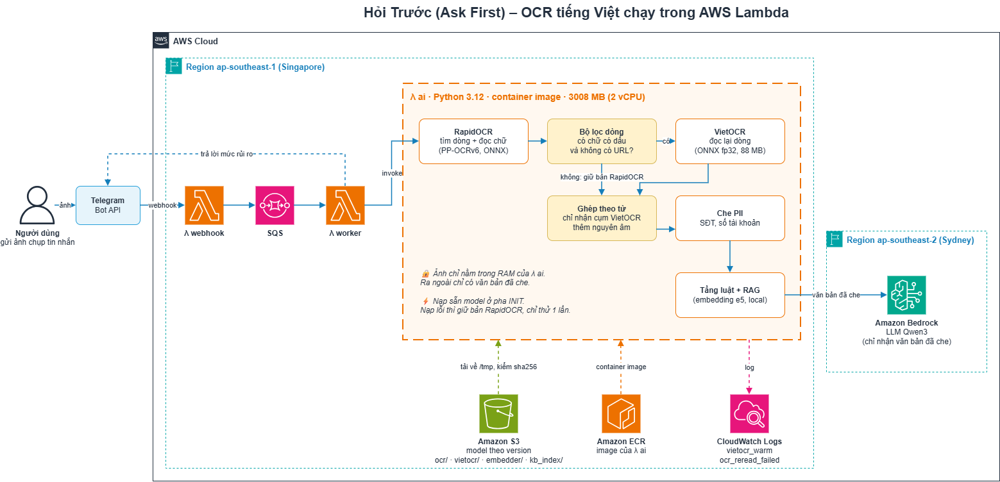

# Vietnamese OCR on AWS Lambda: when the model reads "chuyển tiền" as "chuyn tin"

*Re-reading with a second model, merging word by word, running on Lambda with ONNX and S3*

**Author:** Vo Hoang Quoc Minh (AI2, Ask First team)

{}
Link to the AWS Study Group post: Minh will add it after publishing.
{}
<!-- NHÁP: Minh fills in the Facebook post link and publish date -->

A screenshot contains the sentence "Quý khách vui lòng chuyển tiền vào tài khoản an toàn" ("Please transfer money to a safe account"). The OCR returns:

```text
Quý khách vui lòng chuyn tin vào tài khon an toàn
```

These are not lost diacritics. The model drops the vowels entirely. For a scam-detection bot, "chuyển tiền" (transfer money) is one of the most important phrases to catch.

This post describes how our team fixed that in the Ask First (Hỏi Trước) project, under one constraint: OCR must run inside AWS Lambda, with no GPU and without sending images to any outside service. Every number here was measured on the team's 66 labelled images and on a real Lambda in `ap-southeast-1`.

## 1. Context: why OCR has to run inside Lambda

Ask First is a Telegram bot that helps elderly people check suspicious messages, links and screenshots before acting on them. The user forwards the content to the bot, and the bot replies with a risk level in plain Vietnamese.

The AI part runs in a Python 3.12 Lambda packaged as a container image with 3008 MB of memory. The pipeline is: read text from the image (OCR) → mask personal data → rules layer → find the most similar scam scenario (RAG) → LLM on Amazon Bedrock → combine scores.

Design principle: raw images are only processed by models running locally inside Lambda. Only text with phone and account numbers masked leaves the Lambda. That is why OCR does not use an external service; it runs RapidOCR (PaddleOCR PP-OCRv6 models in ONNX format) directly on the Lambda CPU.

## 2. Symptom: losing diacritics is fine, losing letters is not

The rules layer matches on text with diacritics removed. "chuyển tiền", "chuyen tien" and "chuyền tiến" all become "chuyen tien" before comparison. We stripped every diacritic from the ground-truth text of the 66 images: not a single image changed its rule result. Losing diacritics is not the problem.

The problem is losing letters:

| Correct text | OCR output |
|---|---|
| chuyển tiền (transfer money) | chuyn tin |
| tài khoản (account) | tài khon |
| số tiền (amount) | s tin |
| điểm (points) | đim |

"chuyn tin" without diacritics is still "chuyn tin", so the rule does not match. Across the 66 images, 15/33 rule signals were lost purely because of this. The share of accented words read correctly was 37% on the 50-image set and 27% on the 16-image set.

The cause sits inside the model file itself. The character dictionary of `PP-OCRv6_rec_small` (stored in the ONNX file metadata) has 18,708 characters. It includes á à ã â ă ê ô ơ ư đ but lacks 88 Vietnamese characters such as ả ạ ấ ộ ữ ự. With no character to emit, the model simply drops it. This is already reported on PaddleOCR's GitHub ([issue #18254](https://github.com/PaddlePaddle/PaddleOCR/issues/18254)).

## 3. Why not just replace the model

The first idea everyone has: switch to another model.

- The larger v6 model: same dictionary, same gaps.
- PP-OCRv5 latin: missing 99 characters, and worse at reading URLs.
- VietOCR alone (a Vietnamese-specific model): in our initial comparison, PaddleOCR detection + VietOCR recognition transcribed only 9/32 URLs correctly, versus 31/32 for RapidOCR.

For an anti-scam bot, a URL with one wrong character breaks the whole domain check. So the question is not which model is better, but how to let each model do what it is good at:

- **RapidOCR:** detect lines, read URLs, phone numbers and digits.
- **VietOCR:** read accented Vietnamese words.

## 4. Approach: selective re-reading, word-level merging

How one image is processed:



```text
Image
 |
RapidOCR: detect lines + read each line
 |
Line has at least 1 accented word and no URL?
 |-- no  --> keep RapidOCR text
 |-- yes --> crop the line, VietOCR re-reads it
               |
              merge word by word with RapidOCR text
 |
Final text --> mask PII --> rules layer --> ...
```

**Line filter.** If RapidOCR already produced at least one accented word on a line, the line is almost certainly Vietnamese and may have lost letters. Lines containing a URL are not sent, because VietOCR often misreads URL endings. Across the 66 images, only 552 of 1,254 lines were sent for re-reading.

We tried removing the filter and sending every line: correct URLs on the 16-image set dropped from 17/18 to 10/18, phone numbers from 20/20 to 15/20. The filter is mandatory.

**Merge per word, not per line.** Our first version accepted or rejected whole lines and ran into two problems:

- Lines mixing words and digits, such as "Gi chót đồi quà! 9082 đim": VietOCR misread the digits, so the whole line had to be rejected, losing the correct words too.
- Scam messages that inject characters like "Ta,i,D'en'S;o'" to dodge filters: VietOCR reads something completely different, so those lines were rejected as well.

The current version keeps the RapidOCR string and only replaces individual letter groups when VietOCR merely adds vowels:

- Same consonant skeleton: "chuyn" and "chuyển" both have the skeleton c-h-y-n.
- VietOCR only adds vowels; it never removes them or changes consonants.
- Same upper/lower case pattern.
- Digits, punctuation, URLs and emails always keep the RapidOCR version.

Result for the line above:

```text
RapidOCR:     Gi chót đồi quà! 9082 đim
After merge:  Giờ chót đồi quà! 9082 điểm
```

("đồi" still has the wrong tone mark because RapidOCR's dictionary has ồ but not ổ. The rules layer strips diacritics before matching, so this has no effect.)

Cases that are not merged: VietOCR reading "+84 79 9165198" as "48479 91651980" (digits keep the RapidOCR version), and "BanK" as "Bank" (a case change, rejected).

Moving from line-level to word-level merging raised the share of correct accented words from 82% to 89% (50 images) and from 51% to 97% (16 images). The 16-image set contains many character-injected messages, so it improved the most.

## 5. Shipping to Lambda: four decisions

### a) Run with ONNX Runtime, keep PyTorch out of the image

The original VietOCR is written in PyTorch. We exported it to ONNX as 3 files: `cnn.onnx` (79 MB), `encoder.onnx` and `decoder.onnx`, about 88 MB in total. Lambda only needs `onnxruntime`, `numpy` and `Pillow`, which RapidOCR already uses. No new dependency, and the image does not grow by hundreds of MB for PyTorch.

Decoding runs step by step in a Python loop. Precomputing the attention part that depends only on the encoder (once per line instead of once per step) made it about 2.7 times faster over 1,254 lines (measured on a dev machine), with identical output text.

### b) Models live on S3, not inside the image

Model files are uploaded to S3 under a versioned prefix (`vietocr/vgg-seq2seq-0.3.13-fp32/`). A config file in the repo records the version, prefix and the sha256 of each file. On startup, Lambda downloads them to `/tmp` and verifies sha256 before loading. To disable VietOCR, remove the version from the config file; no code change needed. To change the model, change the version; the old one stays on S3 for rollback.

### c) Preload during the INIT phase

Lambda has an INIT phase that runs once when a new execution environment is created, before the first request. We preload OCR and VietOCR there (running a small blank image through them). Otherwise the first user of every container waits longer: loading VietOCR alone adds about 1.1 seconds.

### d) If loading fails, try only once

If the files are not on S3 yet (for example, code deployed before the model was uploaded), the first load fails. OCR then still returns the RapidOCR text, logs one warning line, and that container skips re-reading until Lambda replaces it. No S3 call per image, and no failed request because of an auxiliary step.

## 6. Measuring on a real Lambda

Every decision above was re-checked on a real Lambda, not just on a laptop. The method: package the 66 images into a temporary image together with production code and models, deploy it as a separate 3008 MB function, invoke it twice (the second run on a warm container), compare output with the dev machine, then delete the function and the image tag. The whole run takes a few minutes.

This is how we picked the right model variant. The int8 version (smaller and faster) did well on a laptop but clearly worse on Lambda's CPU, so we chose fp32. With fp32, the output on Lambda matched the dev machine on all 66/66 images. The latency numbers in this post are also Lambda measurements, not CI-machine numbers.

## 7. Results

The 50-image set is for development and the 16-image set is for testing. All images are synthetic or redacted; none contain real personal data.

| Metric | RapidOCR only | + VietOCR |
|---|---|---|
| Correct URLs (50 · 16 images) | 31/32 · 17/18 | 31/32 · 17/18 |
| Correct phone numbers | 16/16 · 20/20 | 16/16 · 20/20 |
| Correct accented words, 50 images | 37% | 89% |
| Correct accented words, 16 images | 27% | 97% |
| CER (50 · 16 images) | 12.8% · 7.1% | 6.8% · 5.3% |
| Lost rule signals | 15/33 | 6/33 |

URLs and phone numbers are unchanged, exactly what the filter was meant to protect. Lost rule signals dropped by more than half; the remainder mostly comes from other causes such as phrases split across two lines or lines containing URLs.

## 8. Trade-offs: latency and cost

On a 3008 MB Lambda, re-reading adds p50 0.56 seconds per image. Images with many Vietnamese lines add more, since VietOCR reads line by line.

On cost, Lambda bills per GB-second. The x86 price in Singapore is 0.0000166667 USD/GB-second (AWS Price List API, first tier). With 3008 MB (about 2.94 GB):

- 0.56 extra seconds ≈ 1.65 GB-seconds ≈ 0.000027 USD per image
- 1,000 images ≈ 0.03 USD

The cost is negligible compared with catching the right scam phrases.

Next optimisation directions:

- **More memory.** Lambda allocates CPU in proportion to memory: about 1,769 MB equals 1 vCPU, up to 10,240 MB with 6 vCPUs. 3008 MB currently gives 2 vCPUs. More vCPUs can shorten run time, so total cost may not increase.
- **Read several lines in parallel** to use those vCPUs.
- **Try arm64 Lambda (Graviton)**, cheaper than x86 per GB-second.
- **Add new image sets** to keep validating accuracy.

## Conclusion

Three takeaways from our team:

- **Diagnose the symptom correctly before fixing.** "Lost diacritics" and "lost letters" look alike but have very different impact. One small test (stripping all diacritics from the ground truth) pointed straight at the real failure.
- **You do not need a perfect model.** Two models, each doing what it does best, plus a strict enough merge rule, beat replacing the model outright.
- **Measure in the real environment.** A temporary Lambda function, run for a few minutes and then deleted, gives trustworthy numbers for choosing models and configuration before deploying.

### References

1. [PaddleOCR issue #18254 (PP-OCRv6 missing Vietnamese characters)](https://github.com/PaddlePaddle/PaddleOCR/issues/18254)
2. [RapidOCR](https://github.com/RapidAI/RapidOCR)
3. [VietOCR](https://github.com/pbcquoc/vietocr)
4. [AWS Lambda: Configure memory (memory and vCPU)](https://docs.aws.amazon.com/lambda/latest/dg/configuration-memory.html)
5. [AWS Lambda: Execution environment lifecycle (INIT phase)](https://docs.aws.amazon.com/lambda/latest/dg/lambda-runtime-environment.html)
6. [AWS Lambda: Container images](https://docs.aws.amazon.com/lambda/latest/dg/images-create.html)
7. [AWS Lambda pricing](https://aws.amazon.com/lambda/pricing/)
8. [ONNX Runtime quantization](https://onnxruntime.ai/docs/performance/model-optimizations/quantization.html)

`#AWS #AWSStudyGroup #FCAJ #FirstCloudJourney #AWSLambda #AmazonS3 #OCR #ONNX #Serverless #TiengViet`
