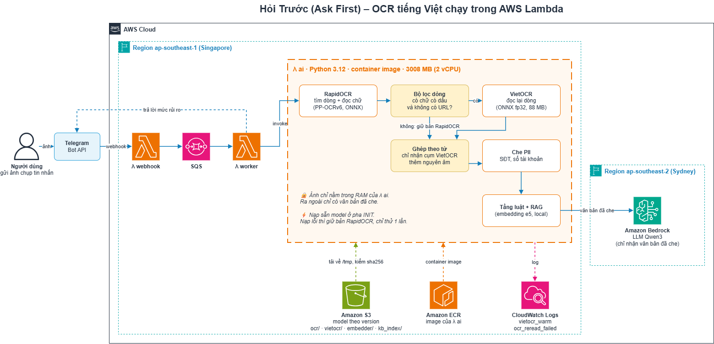

# OCR tiếng Việt trên AWS Lambda: khi model đọc "chuyển tiền" thành "chuyn tin"

*Đọc lại bằng model thứ hai, ghép theo từng từ, chạy trên Lambda bằng ONNX và S3*

**Tác giả:** Võ Hoàng Quốc Minh (AI2, nhóm Ask First)

{}
Bài này tôi đã gửi lên group AWS Study Group nhưng chưa được duyệt đăng, nên chưa có link bài đăng. Toàn văn bài được giữ tại đây.
{}

Ảnh chụp màn hình có câu "Quý khách vui lòng chuyển tiền vào tài khoản an toàn". OCR trả về:

```text
Quý khách vui lòng chuyn tin vào tài khon an toàn
```

Không phải mất dấu. Model bỏ hẳn cả nguyên âm. Với một con bot phát hiện lừa đảo, "chuyển tiền" là một trong những cụm từ quan trọng nhất cần bắt được.

Bài này kể lại cách nhóm mình xử lý lỗi đó trong dự án Hỏi Trước (Ask First), với ràng buộc: OCR phải chạy ngay trong AWS Lambda, không GPU, không gửi ảnh ra ngoài. Mọi con số trong bài đo trên 66 ảnh có nhãn của nhóm và trên Lambda thật ở `ap-southeast-1`.

## 1. Bối cảnh: vì sao OCR phải chạy trong Lambda

Hỏi Trước là bot Telegram giúp người cao tuổi kiểm tra tin nhắn, link, ảnh chụp màn hình đáng ngờ trước khi làm theo. Người dùng chuyển tiếp nội dung cho bot, bot trả lời mức rủi ro bằng tiếng Việt dễ hiểu.

Phần AI chạy trong một Lambda Python 3.12 đóng gói bằng container image, 3008 MB RAM. Pipeline gồm: đọc chữ từ ảnh (OCR) → che thông tin cá nhân → tầng luật → tìm kịch bản lừa đảo giống nhất (RAG) → LLM trên Amazon Bedrock → gộp điểm.

Nguyên tắc thiết kế: ảnh thô chỉ được xử lý bằng model chạy local trong Lambda. Ra khỏi Lambda chỉ có văn bản đã che số điện thoại, số tài khoản. Vì vậy OCR không dùng dịch vụ bên ngoài, mà chạy RapidOCR (model PaddleOCR PP-OCRv6 dạng ONNX) ngay trên CPU của Lambda.

## 2. Triệu chứng: mất dấu thì không sao, mất chữ cái mới hỏng

Tầng luật so khớp trên chữ đã bỏ dấu. "chuyển tiền", "chuyen tien" hay "chuyền tiến" đều thành "chuyen tien" trước khi so. Nhóm mình thử bỏ hết dấu trong chữ đáp án của 66 ảnh: không ảnh nào đổi kết quả luật. Mất dấu không phải vấn đề.

Vấn đề là mất chữ cái:

| Chữ đúng | OCR đọc ra |
|---|---|
| chuyển tiền | chuyn tin |
| tài khoản | tài khon |
| số tiền | s tin |
| điểm | đim |

"chuyn tin" bỏ dấu vẫn là "chuyn tin", luật không khớp. Trên 66 ảnh, 15/33 tín hiệu luật bị mất chỉ vì lỗi này. Tỉ lệ từ có dấu đọc đúng: 37% trên bộ 50 ảnh, 27% trên bộ 16 ảnh.

Nguyên nhân nằm trong chính file model. Bảng chữ của `PP-OCRv6_rec_small` (lưu trong metadata của file ONNX) có 18.708 ký tự, có á à ã â ă ê ô ơ ư đ, nhưng thiếu 88 chữ tiếng Việt như ả ạ ấ ộ ữ ự. Model không có ký tự để in nên bỏ luôn. Lỗi này đã được ghi nhận trên GitHub của PaddleOCR ([issue #18254](https://github.com/PaddlePaddle/PaddleOCR/issues/18254)).

## 3. Vì sao không thay hẳn model

Cách đầu tiên ai cũng nghĩ tới: đổi sang model khác.

- Đổi sang bản v6 lớn hơn: dùng chung bảng chữ, vẫn thiếu.
- Đổi sang PP-OCRv5 latin: thiếu 99 chữ, và đọc URL kém hơn.
- Dùng hẳn VietOCR (model chuyên tiếng Việt): trong đợt so sánh ban đầu, PaddleOCR tìm dòng + VietOCR đọc chỉ chép đúng 9/32 URL, so với 31/32 của RapidOCR.

Với bot chống lừa đảo, URL sai một ký tự là hỏng cả bước kiểm tra tên miền. Nên bài toán không phải chọn model nào tốt hơn, mà là để mỗi model làm phần nó giỏi:

- **RapidOCR:** tìm dòng, đọc URL, số điện thoại, số.
- **VietOCR:** đọc chữ tiếng Việt có dấu.

## 4. Cách làm: đọc lại có chọn lọc, ghép theo từng từ

Luồng xử lý một ảnh:



```text
Ảnh
 |
RapidOCR: tìm dòng + đọc từng dòng
 |
Dòng có ít nhất 1 chữ có dấu, không có URL?
 |-- không --> giữ bản RapidOCR
 |-- có ----> cắt ảnh dòng, VietOCR đọc lại
               |
              ghép theo từng từ với bản RapidOCR
 |
Văn bản cuối --> che PII --> tầng luật --> ...
```

**Bộ lọc dòng.** Dòng nào RapidOCR đã đọc ra ít nhất một chữ có dấu thì gần như chắc là tiếng Việt và có thể đã mất chữ. Dòng có URL thì không gửi, vì VietOCR hay đọc sai đuôi URL. Trên 66 ảnh, chỉ 552/1.254 dòng được gửi đọc lại.

Thử bỏ bộ lọc, gửi mọi dòng: URL đúng trên bộ 16 ảnh tụt từ 17/18 xuống 10/18, số điện thoại từ 20/20 xuống 15/20. Bộ lọc là bắt buộc.

**Ghép theo từ, không nhận nguyên dòng.** Bản đầu tiên nhóm mình làm kiểu "nhận hoặc bỏ cả dòng" và gặp hai vấn đề:

- Dòng lẫn số như "Gi chót đồi quà! 9082 đim": VietOCR đọc sai số, nên phải bỏ cả dòng, mất luôn phần chữ đúng.
- Tin lừa đảo chèn ký tự kiểu "Ta,i,D'en'S;o'" để né bộ lọc: VietOCR đọc khác hẳn, cũng phải bỏ.

Bản hiện tại giữ nguyên chuỗi của RapidOCR, chỉ thay từng cụm chữ cái khi VietOCR chỉ thêm nguyên âm:

- Cùng bộ khung phụ âm: "chuyn" và "chuyển" đều có khung c-h-y-n.
- VietOCR chỉ thêm nguyên âm, không bớt, không đổi phụ âm.
- Cùng kiểu chữ hoa/thường.
- Số, dấu câu, URL, email luôn giữ bản RapidOCR.

Kết quả với dòng ở trên:

```text
RapidOCR: Gi chót đồi quà! 9082 đim
Sau ghép: Giờ chót đồi quà! 9082 điểm
```

("đồi" vẫn sai dấu vì bảng chữ của RapidOCR có ồ nhưng không có ổ. Tầng luật bỏ dấu trước khi so nên chỗ này không ảnh hưởng.)

Các trường hợp không ghép: VietOCR đọc "+84 79 9165198" thành "48479 91651980" (số giữ nguyên bản RapidOCR), "BanK" thành "Bank" (đổi hoa thường, không nhận).

Đổi từ ghép theo dòng sang ghép theo từ làm tỉ lệ từ có dấu đúng tăng từ 82% lên 89% (50 ảnh) và từ 51% lên 97% (16 ảnh). Bộ 16 ảnh có nhiều tin chèn ký tự nên tăng mạnh nhất.

## 5. Đưa lên Lambda: bốn quyết định

### a) Chạy bằng ONNX Runtime, không đưa PyTorch vào image

VietOCR gốc viết bằng PyTorch. Nhóm mình xuất model sang ONNX thành 3 file: `cnn.onnx` (79 MB), `encoder.onnx`, `decoder.onnx`, tổng khoảng 88 MB. Lambda chỉ cần `onnxruntime`, `numpy`, `Pillow`, vốn đã có sẵn vì RapidOCR dùng. Không thêm dependency nào, image không phình thêm cả trăm MB vì PyTorch.

Phần giải mã chạy từng bước trong vòng lặp Python. Tính sẵn phần attention chỉ phụ thuộc encoder (một lần cho mỗi dòng thay vì mỗi bước) giúp nhanh hơn khoảng 2,7 lần trên 1.254 dòng (đo trên máy dev), chữ ra giữ nguyên.

### b) Model nằm trên S3, không đóng vào image

File model được upload lên S3 theo prefix có version (`vietocr/vgg-seq2seq-0.3.13-fp32/`). Một file cấu hình trong repo ghi version, prefix và sha256 từng file. Khi khởi động, Lambda tải về `/tmp` và kiểm sha256 trước khi nạp. Muốn tắt VietOCR, chỉ cần xoá version trong file cấu hình, không sửa code. Muốn đổi model thì đổi version, bản cũ vẫn còn trên S3 để quay lại.

### c) Nạp trước ở pha INIT

Lambda có pha INIT chạy một lần khi tạo môi trường mới, trước request đầu tiên. Nhóm mình nạp sẵn OCR và VietOCR ở đây (chạy thử một ảnh trắng nhỏ). Nếu không, người dùng đầu tiên của mỗi container phải chờ thêm: riêng lần nạp VietOCR mất thêm khoảng 1,1 giây.

### d) Nạp lỗi thì chỉ thử một lần

Nếu S3 chưa có file (ví dụ deploy code trước khi upload model), lần nạp đầu sẽ lỗi. Lúc đó OCR vẫn trả bản RapidOCR, ghi một dòng log cảnh báo, và container đó bỏ bước đọc lại cho tới khi Lambda thay container mới. Không gọi S3 lại cho từng ảnh, không làm hỏng cả request vì một bước phụ.

## 6. Đo trên Lambda thật

Mọi quyết định ở trên đều được kiểm lại trên Lambda thật, không chỉ trên laptop. Cách làm: đóng gói 66 ảnh vào một image tạm cùng code và model production, deploy thành function riêng 3008 MB, gọi hai lượt (lượt hai là container ấm), so chữ ra với máy dev, đo xong thì xoá function và image tag. Toàn bộ chỉ mất vài phút chạy.

Nhờ vậy nhóm mình chọn được đúng bản model. Bản int8 (nhỏ và nhanh hơn) cho kết quả tốt trên laptop nhưng kém hơn rõ trên CPU của Lambda, nên nhóm chọn fp32. Với fp32, chữ ra trên Lambda trùng máy dev đủ 66/66 ảnh. Số độ trễ trong bài cũng là số đo trên Lambda, không phải trên máy CI.

## 7. Kết quả

Bộ 50 ảnh để phát triển, bộ 16 ảnh để kiểm tra. Ảnh đều là ảnh tổng hợp hoặc đã che thông tin, không có dữ liệu cá nhân thật.

| Chỉ số | Chỉ RapidOCR | + VietOCR |
|---|---|---|
| URL đúng (50 · 16 ảnh) | 31/32 · 17/18 | 31/32 · 17/18 |
| SĐT đúng | 16/16 · 20/20 | 16/16 · 20/20 |
| Từ có dấu đúng, 50 ảnh | 37% | 89% |
| Từ có dấu đúng, 16 ảnh | 27% | 97% |
| CER (50 · 16 ảnh) | 12,8% · 7,1% | 6,8% · 5,3% |
| Tín hiệu luật bị mất | 15/33 | 6/33 |

URL và số điện thoại giữ nguyên, đúng như mục tiêu của bộ lọc. Số tín hiệu luật bị mất giảm hơn một nửa; phần còn lại chủ yếu đến từ nguyên nhân khác như cụm từ bị ngắt qua hai dòng hay dòng chứa URL.

## 8. Đánh đổi: độ trễ và chi phí

Trên Lambda 3008 MB, bước đọc lại làm mỗi ảnh chậm thêm p50 0,56 giây. Ảnh nhiều dòng tiếng Việt thì thêm nhiều hơn, vì VietOCR đọc từng dòng.

Về tiền, Lambda tính theo GB-giây. Giá x86 ở Singapore là 0,0000166667 USD/GB-giây (AWS Price List API, bậc đầu). Với 3008 MB (khoảng 2,94 GB):

- 0,56 giây thêm ≈ 1,65 GB-giây ≈ 0,000027 USD mỗi ảnh
- 1.000 ảnh ≈ 0,03 USD

Chi phí gần như không đáng kể so với việc bắt đúng các cụm từ lừa đảo.

Hướng tối ưu tiếp theo:

- **Tăng memory.** Lambda cấp CPU theo memory: khoảng 1.769 MB tương ứng 1 vCPU, tối đa 10.240 MB với 6 vCPU. 3008 MB đang có 2 vCPU. Thêm vCPU có thể rút ngắn thời gian chạy, nên tổng chi phí chưa chắc tăng.
- **Đọc nhiều dòng song song** để tận dụng số vCPU đó.
- **Thử Lambda arm64 (Graviton)**, rẻ hơn x86 trên mỗi GB-giây.
- **Bổ sung bộ ảnh mới** để tiếp tục kiểm chứng độ chính xác.

## Kết

Ba điều nhóm mình rút ra:

- **Đọc đúng triệu chứng trước khi sửa.** "Mất dấu" và "mất chữ cái" trông giống nhau nhưng tác động khác hẳn. Một phép thử nhỏ (bỏ hết dấu trong chữ đáp án) chỉ ra ngay chỗ hỏng thật.
- **Không cần một model hoàn hảo.** Hai model, mỗi cái làm phần mình giỏi, cộng một quy tắc ghép đủ chặt, tốt hơn thay hẳn model.
- **Đo trên môi trường thật.** Một function Lambda tạm, chạy vài phút rồi xoá, cho con số đáng tin để chọn model và cấu hình trước khi deploy.

### Tài liệu tham khảo

1. [PaddleOCR issue #18254 (PP-OCRv6 thiếu ký tự tiếng Việt)](https://github.com/PaddlePaddle/PaddleOCR/issues/18254)
2. [RapidOCR](https://github.com/RapidAI/RapidOCR)
3. [VietOCR](https://github.com/pbcquoc/vietocr)
4. [AWS Lambda: Configure memory (memory và vCPU)](https://docs.aws.amazon.com/lambda/latest/dg/configuration-memory.html)
5. [AWS Lambda: Execution environment lifecycle (pha INIT)](https://docs.aws.amazon.com/lambda/latest/dg/lambda-runtime-environment.html)
6. [AWS Lambda: Container images](https://docs.aws.amazon.com/lambda/latest/dg/images-create.html)
7. [AWS Lambda pricing](https://aws.amazon.com/lambda/pricing/)
8. [ONNX Runtime quantization](https://onnxruntime.ai/docs/performance/model-optimizations/quantization.html)

`#AWS #AWSStudyGroup #FCAJ #FirstCloudJourney #AWSLambda #AmazonS3 #OCR #ONNX #Serverless #TiengViet`
