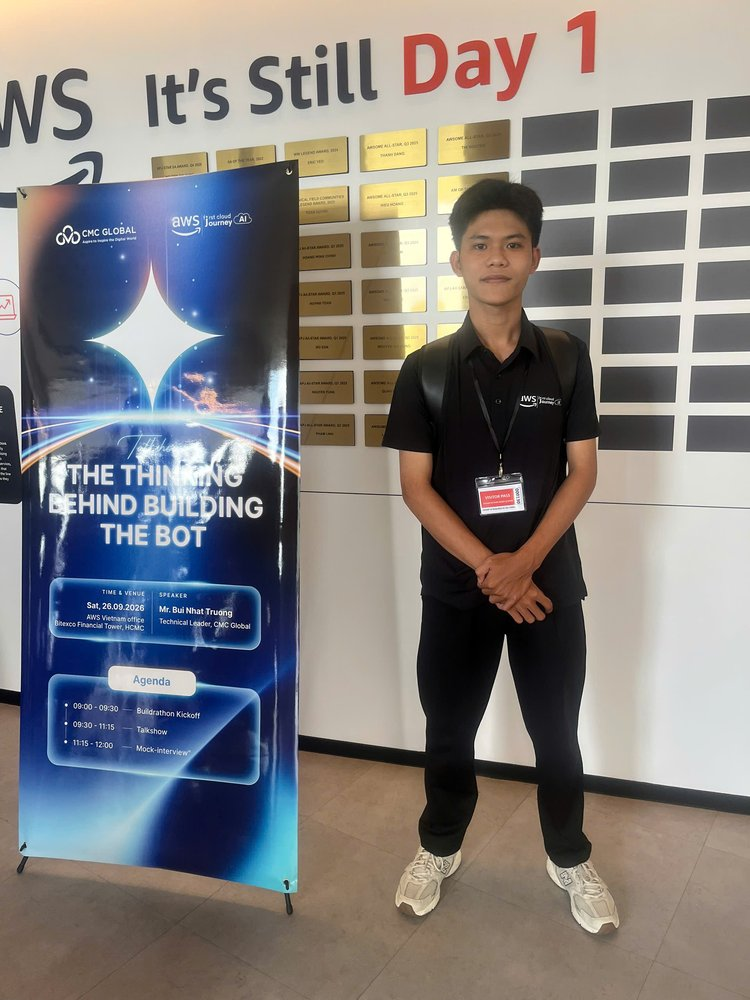
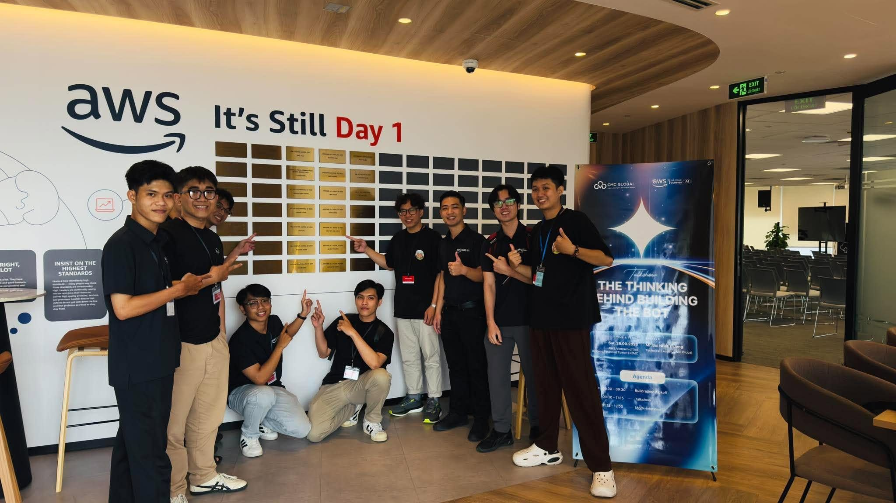

# Buildrathon Kickoff: Code the Future with CMC Global

| Thông tin | Chi tiết |
|---|---|
| Ngày giờ | Thứ Bảy, 26/09/2026, 09:00–12:00 |
| Địa điểm | Văn phòng AWS, Tầng 26 tòa Bitexco, TP.HCM |
| Đơn vị tổ chức | AWS First Cloud AI Journey (FCAJ) phối hợp CMC Global |
| Diễn giả | Thien Lu, Phong Pham (Program Manager, FCAJ); Bùi Nhật Trường (Technical Leader, CMC Global) |
| Vai trò của tôi | Người tham dự |

### Chương trình

Buổi sáng chia làm ba phần: mở màn Buildrathon (09:00–09:30), talkshow "The Thinking Behind Building the Bot" (09:30–11:15) và phỏng vấn thử (11:15–12:00).

### Điều tôi tiếp thu

Sự kiện diễn ra ở tuần thứ hai của kỳ thực tập, khi tôi còn đang ôn lại kiến thức AWS cơ bản và chưa có phần việc cụ thể trong dự án. Tôi ghi lại ba ý:

1. **Đầu vào thực tế khác đầu vào trong demo.** Phần talkshow nói nhiều về chuyện người dùng gửi cho bot những thứ không ai lường trước. Ý này về sau rất sát với tôi: ảnh chụp màn hình người cao tuổi gửi cho Ask First có chữ bị cắt, có tin chèn ký tự để né lọc, và model OCR làm rơi chữ cái tiếng Việt.
2. **Phải có cách biết bot đang đúng hay sai.** Một bot không có bộ dữ liệu kiểm tra thì mỗi lần sửa là một lần đoán. Đây là lý do tôi coi trọng việc dựng bộ ảnh có nhãn trước khi chọn model OCR.
3. **Trình bày ngắn về việc mình làm.** Phần phỏng vấn thử cho tôi thấy mình chưa quen tóm tắt một việc kỹ thuật trong vài câu.

### Liên hệ với phần việc của tôi

Tháng 10, khi nhận spike OCR (AI-20), tôi bắt đầu từ bộ 50 ảnh có nhãn rồi mới so ba hướng OCR chạy local ([PR #97](https://github.com/ask-first-fcaj/ask-first/pull/97)), sau đó thêm tập kiểm tra độc lập 16 ảnh ([PR #99](https://github.com/ask-first-fcaj/ask-first/pull/99)) để không tự chấm trên chính dữ liệu mình đã nhìn. Cách làm này đến từ ý thứ hai ở trên.

### Bài học

- Dữ liệu kiểm tra nên có trước model.
- Tập nói một việc kỹ thuật theo thứ tự: vấn đề, cách đo, kết quả.

### Ảnh check-in

