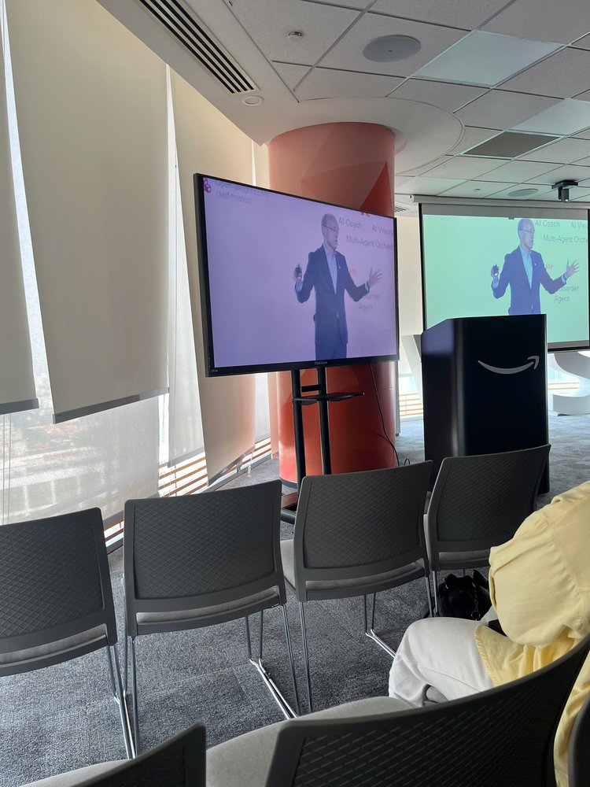
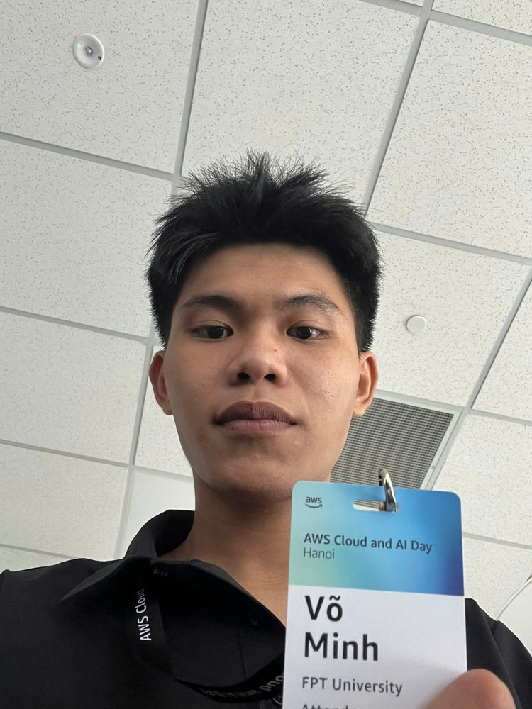
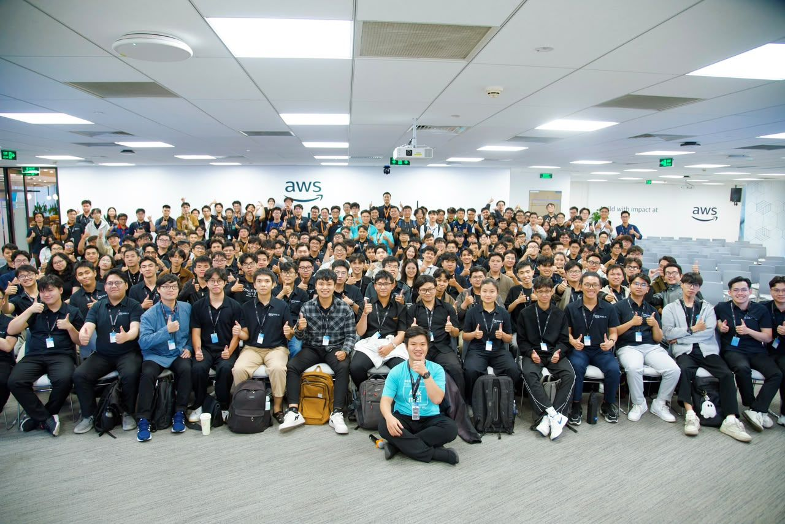

# AWS Cloud & AI Day Vietnam 2026: Ho Chi Minh City Watch Party

| Item | Details |
|---|---|
| Date | Tuesday, 29/09/2026 |
| Venue | AWS office, 26th floor, Bitexco Tower, Ho Chi Minh City (live stream from the main stage in Hanoi) |
| Overall theme | Agentic AI |
| Speakers | AWS leaders and AWS customers (live keynote) |
| My role | Attendee |

### Programme

- Live keynote: customers describing how they use Agentic AI to modernise and scale their systems.
- Selected technical sessions from the "Builders x AI" track.
- On-site networking with engineers and tech practitioners in Ho Chi Minh City.

### What I took away

I watched the event with one question in mind: when should AI decide, and when should code decide? What I noted:

- **Retrieve first, generate second.** Many customer stories fed internal data in before calling the model, instead of relying on what the model remembers. That is RAG.
- **Every step must be measurable.** With a multi-step system, you need to know which step went wrong, not just that the final answer is wrong.
- **Cost follows each call.** An AI feature that is cheap in a trial can become expensive in production if the number of model calls is not estimated up front.

<!-- NHÁP: takeaways need Minh's confirmation -->

### Connection to my work

- **RAG.** Six weeks later I built the local RAG for Ask First: a corpus of 103 scam warnings, an int8 e5-small embedder and a retriever ([PR #147](https://github.com/ask-first-fcaj/ask-first/pull/147)), then wired it into the real pipeline with scenario-based citations ([PR #151](https://github.com/ask-first-fcaj/ask-first/pull/151)). Running the embedder inside Lambda means the team does not pay for a separate vector service.
- **Measuring each step.** The "every step must be measurable" idea is why I built separate measurements: PII masking on 500 samples ([PR #158](https://github.com/ask-first-fcaj/ask-first/pull/158)), the OTP rule ([PR #159](https://github.com/ask-first-fcaj/ask-first/pull/159)), and an eval gate that runs on every PR ([PR #153](https://github.com/ask-first-fcaj/ask-first/pull/153)).
- **Cost.** In my OCR blog I converted VietOCR's extra latency into GB-seconds and USD per 1,000 images instead of just saying "a bit slower".

### Lesson

A trustworthy AI system does not come from the biggest model, but from every step having a measurement and a clear limit.

### Check-in photos

