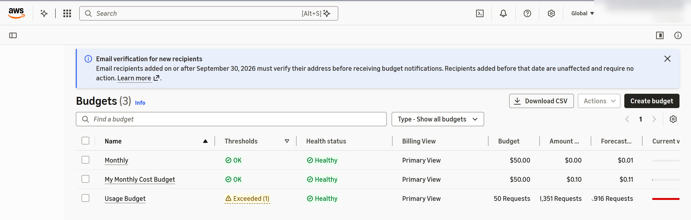
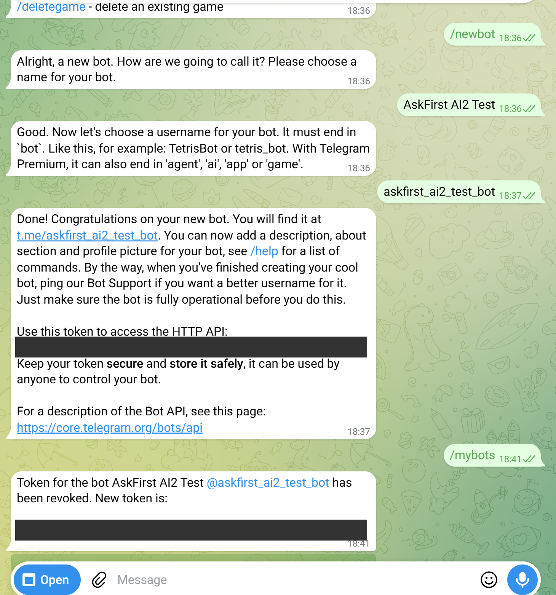

This section is done once. It takes about 45 minutes, mostly for installing tools.

#### Step 1: Secure the account before creating resources

1. Enable **MFA on the root account**, and stop using root for day-to-day work.
2. Create a dedicated **IAM user** for deployment (I use the user `ai2-dev`). The workshop needs permissions to create CloudFormation stacks, Lambda, IAM roles, DynamoDB, SQS, S3, ECR, SSM, CloudWatch, SNS, and to call Bedrock. In a learning account, the quickest approach is to add the user to a group with `AdministratorAccess`; in a shared account, restrict permissions to the services listed above.
3. Create **AWS Budgets** to receive an email when spending exceeds a threshold. I set a budget of 50 USD/month with alerts at 80% and 100%.



#### Step 2: Enable Amazon Bedrock models in Sydney

The `ai` Lambda runs in Singapore (`ap-southeast-1`) but calls Bedrock in Sydney (`ap-southeast-2`), because when the team chose the models, Sydney offered the open-weight models while Singapore did not yet. The two models required:

| Role | Model ID |
|---|---|
| Primary evaluator (judge) | `qwen.qwen3-32b-v1:0` |
| Fallback when the judge fails | `openai.gpt-oss-120b-1:0` |

Verify directly with the CLI rather than only looking at the console. The command below sends a short prompt to Qwen3 32B:

```powershell
aws bedrock-runtime converse --region ap-southeast-2 `
  --model-id qwen.qwen3-32b-v1:0 `
  --messages '[{"role":"user","content":[{"text":"Trả lời 1 từ: xin chào"}]}]' `
  --inference-config maxTokens=20 `
  --query "output.message.content[0].text" --output text
```

Result on my account (27/11/2026):

```text
Chào
```

If you get an `AccessDeniedException`, open **Amazon Bedrock → Model access** in the `ap-southeast-2` Region and request access to the two models above.

#### Step 3: Install the tools

The versions below are the ones I used when writing the workshop; newer versions also work.

| Tool | Version used | Used for |
|---|---|---|
| AWS CLI v2 | 2.41.1 | All AWS commands |
| AWS SAM CLI | 1.173.0 | Building and deploying the backend stack |
| Java (Temurin JDK) | 21.0.13 | Building the 3 Java Lambda functions |
| Docker Desktop | 29.5.3 | Building the `ai` Lambda image |
| Python + uv | Python 3.13, uv 0.12.5 | Running the AI scripts (downloading models, uploading to S3, testing) |
| Git | 2.45 | Fetching the source code |

{}
**SAM requires the `mvn` command, but the repo only ships the Maven Wrapper (`mvnw.cmd`).** If Maven is not installed, `sam build` reports that `mvn` cannot be found. My workaround: create an `mvn.cmd` file that points to the repo's wrapper and put that folder at the front of `PATH` (see 5.4, step 3). `sam build` must be run in **PowerShell**; Git Bash cannot pass this shim through to SAM.
{}

#### Step 4: Configure the AWS CLI with a named profile

```powershell
aws configure --profile ai2test        # enter the IAM user's access key, region ap-southeast-1
$env:AWS_PROFILE = "ai2test"            # only applies to this PowerShell window
$env:AWS_DEFAULT_REGION = "ap-southeast-1"
aws sts get-caller-identity
```

The result must be the IAM user you just created, not root:

```json
{
    "UserId": "AIDA...",
    "Account": "<ACCOUNT_ID>",
    "Arn": "arn:aws:iam::<ACCOUNT_ID>:user/ai2-dev"
}
```

#### Step 5: Get the source code

```powershell
git clone https://github.com/ask-first-fcaj/ask-first.git
cd ask-first
git switch main
```

Folders used in the workshop:

| Folder | Contents |
|---|---|
| `infra/` | `template.yaml` (SAM), `samconfig.toml` |
| `backend/ScamProtection/` | Java code for `webhook`, `worker`, `worker-dlq` and the shared `common` module |
| `ai/` | Python code for the `ai` Lambda, `Dockerfile`, `config/artifacts.yaml`, scripts in `ai/scripts/` |
| `kb/`, `prompts/` | Knowledge base of scam scenarios and LLM prompts, packaged into the image |
| `scripts/` | `set_webhook.py`, `set_commands.py` for Telegram |
| `contracts/fixtures/` | Sample requests for test-invoking the `ai` Lambda |

#### Step 6: Create the Telegram bot

In Telegram, open **@BotFather** → send `/newbot` → set a display name and a username (must end with `bot`). BotFather returns a **token** in the form `123456789:AA...`.



{}
The token is the key that controls the bot. I once leaked the token in a screenshot sent to the team and had to `/revoke` it to get a new one. Since then: **redact the token line before taking a screenshot**, and store the token only in SSM (5.4, step 1), never in a `.env` file in the repo or in the command history.
{}
