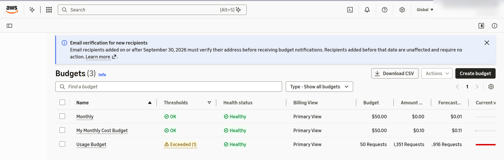
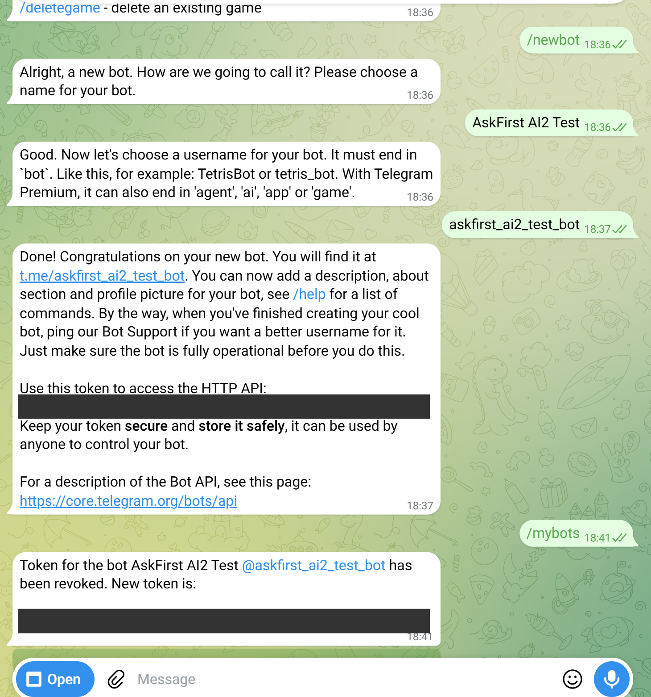

Mục này làm một lần. Thời gian khoảng 45 phút, phần lớn là cài công cụ.

#### Bước 1: Bảo vệ tài khoản trước khi tạo tài nguyên

1. Bật **MFA cho tài khoản root**, sau đó không dùng root cho việc hằng ngày nữa.
2. Tạo một **IAM user** riêng cho việc deploy (tôi dùng user `ai2-dev`). Workshop cần quyền tạo CloudFormation stack, Lambda, IAM role, DynamoDB, SQS, S3, ECR, SSM, CloudWatch, SNS và gọi Bedrock. Trong một tài khoản học tập, cách nhanh nhất là gắn user vào một group có `AdministratorAccess`; trong tài khoản dùng chung, hãy giới hạn theo danh sách dịch vụ trên.
3. Tạo **AWS Budgets** để nhận email khi chi phí vượt ngưỡng. Tôi đặt budget 50 USD/tháng, cảnh báo ở 80% và 100%.



#### Bước 2: Bật model Amazon Bedrock ở Sydney

Lambda `ai` chạy ở Singapore (`ap-southeast-1`) nhưng gọi Bedrock ở Sydney (`ap-southeast-2`), vì lúc nhóm chọn model, Sydney có các model open-weight còn Singapore thì chưa. Hai model cần dùng:

| Vai trò | Model ID |
|---|---|
| Đánh giá chính (judge) | `qwen.qwen3-32b-v1:0` |
| Dự phòng khi judge lỗi | `openai.gpt-oss-120b-1:0` |

Kiểm tra trực tiếp bằng CLI thay vì chỉ nhìn trên console. Lệnh dưới gửi một câu ngắn tới Qwen3 32B:

```powershell
aws bedrock-runtime converse --region ap-southeast-2 `
  --model-id qwen.qwen3-32b-v1:0 `
  --messages '[{"role":"user","content":[{"text":"Trả lời 1 từ: xin chào"}]}]' `
  --inference-config maxTokens=20 `
  --query "output.message.content[0].text" --output text
```

Kết quả trên tài khoản của tôi (27/11/2026):

```text
Chào
```

Nếu nhận `AccessDeniedException`, mở **Amazon Bedrock → Model access** ở Region `ap-southeast-2` và xin quyền cho hai model trên.

#### Bước 3: Cài công cụ

Phiên bản dưới đây là bản tôi dùng khi viết workshop; bản mới hơn vẫn chạy được.

| Công cụ | Phiên bản đã dùng | Dùng để |
|---|---|---|
| AWS CLI v2 | 2.41.1 | Mọi lệnh với AWS |
| AWS SAM CLI | 1.173.0 | Build và deploy stack backend |
| Java (Temurin JDK) | 21.0.13 | Build 3 Lambda Java |
| Docker Desktop | 29.5.3 | Build image của Lambda `ai` |
| Python + uv | Python 3.13, uv 0.12.5 | Chạy script của phần AI (tải model, upload S3, test) |
| Git | 2.45 | Lấy mã nguồn |

{}
**SAM cần lệnh `mvn`, nhưng repo chỉ có Maven Wrapper (`mvnw.cmd`).** Nếu máy không cài Maven, `sam build` báo không tìm thấy `mvn`. Cách tôi dùng: tạo một file `mvn.cmd` trỏ sang wrapper của repo rồi đưa thư mục đó lên đầu `PATH` (xem 5.4, bước 3). Lệnh `sam build` phải chạy trong **PowerShell**; Git Bash không truyền được shim này cho SAM.
{}

#### Bước 4: Cấu hình AWS CLI bằng named profile

```powershell
aws configure --profile ai2test        # nhập access key của IAM user, region ap-southeast-1
$env:AWS_PROFILE = "ai2test"            # chỉ có tác dụng trong cửa sổ PowerShell này
$env:AWS_DEFAULT_REGION = "ap-southeast-1"
aws sts get-caller-identity
```

Kết quả phải là IAM user bạn vừa tạo, không phải root:

```json
{
    "UserId": "AIDA...",
    "Account": "<ACCOUNT_ID>",
    "Arn": "arn:aws:iam::<ACCOUNT_ID>:user/ai2-dev"
}
```

#### Bước 5: Lấy mã nguồn

```powershell
git clone https://github.com/ask-first-fcaj/ask-first.git
cd ask-first
git switch main
```

Các thư mục dùng trong workshop:

| Thư mục | Nội dung |
|---|---|
| `infra/` | `template.yaml` (SAM), `samconfig.toml` |
| `backend/ScamProtection/` | Mã Java của `webhook`, `worker`, `worker-dlq` và module chung `common` |
| `ai/` | Mã Python của Lambda `ai`, `Dockerfile`, `config/artifacts.yaml`, các script trong `ai/scripts/` |
| `kb/`, `prompts/` | Knowledge base về kịch bản lừa đảo và prompt của LLM, được đóng vào image |
| `scripts/` | `set_webhook.py`, `set_commands.py` cho Telegram |
| `contracts/fixtures/` | Các request mẫu để gọi thử Lambda `ai` |

#### Bước 6: Tạo bot Telegram

Trong Telegram, mở **@BotFather** → gửi `/newbot` → đặt tên hiển thị và username (phải kết thúc bằng `bot`). BotFather trả về một **token** dạng `123456789:AA...`.



{}
Token là chìa khoá điều khiển bot. Tôi từng để lộ token trong một ảnh chụp màn hình gửi cho nhóm và phải `/revoke` để lấy token mới. Từ đó: **che dòng token trước khi chụp**, và chỉ lưu token trong SSM (5.4, bước 1), không dán vào file `.env` trong repo hay vào lịch sử lệnh.
{}
