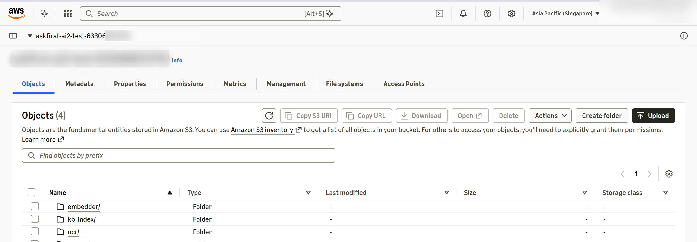

The `ai` Lambda uses four sets of model files. They are **not** inside the container image; they live on S3. When the Lambda starts, it downloads the files to `/tmp/artifacts` and verifies their SHA-256 before loading them.

Why separate the models from the image:

- The image is about 250 MB lighter, so builds and pushes are faster.
- Swapping a model (for example, a new knowledge base index) only requires uploading to S3 and changing one line of configuration, without rebuilding the image.
- Each model version lives under a versioned prefix, so rolling back only requires pointing the configuration to the old prefix.

#### The four artifacts and where they are defined

The single source of truth is `ai/config/artifacts.yaml`: the name, version, S3 prefix, and SHA-256 of every file.

| Artifact | S3 prefix | Contents | Size |
|---|---|---|---|
| `ocr` | `ocr/ppocrv6-small-rapidocr3.10.0/` | RapidOCR: text detection, recognition, and orientation models (ONNX fp32) | 32 MB |
| `vietocr` | `vietocr/vgg-seq2seq-0.3.13-fp32/` | VietOCR exported to ONNX: re-reads Vietnamese lines where RapidOCR drops characters | 90 MB |
| `embedder` | `embedder/e5-small-qint8-614241f/` | int8 `multilingual-e5-small` for generating RAG vectors | 123 MB |
| `kb_index` | `kb_index/kb-2026.11.11/` | Vectors for the 21 scenario cards + 103 warning articles in `kb/` | 0.3 MB |

#### Step 1: Create the model bucket

```powershell
$env:AWS_PROFILE = "ai2test"; $env:AWS_DEFAULT_REGION = "ap-southeast-1"
$acct   = aws sts get-caller-identity --query Account --output text
$bucket = "askfirst-ai2-test-$acct"          # bucket names are globally unique, so append the account ID
aws s3 mb "s3://$bucket"
aws s3api get-public-access-block --bucket $bucket
```

A newly created bucket has all 4 Block Public Access flags enabled; the last command must print all 4 values as `true`.

#### Step 2: Download and build the files

Run in the `ai/` folder. The `fetch_*` scripts stop automatically if the SHA-256 of a downloaded file differs from `artifacts.yaml`.

```powershell
cd ai
uv run python scripts/fetch_ocr_models.py out/ocr
uv run python scripts/fetch_embedder.py out/embedder
uv run python scripts/build_index.py out/embedder out/kb_index --version kb-2026.11.11
```

At the end of the run, `build_index.py` prints the hashes of the two index files. The vectors are floating-point numbers, so running on a different machine may produce differences in the last digit and therefore a different hash. If that happens, copy your hash into the `kb_index` entry of `artifacts.yaml` **before** the image build step in 5.5, because this configuration file is packaged into the image.

**VietOCR** needs PyTorch for the ONNX export, so use a separate Python environment, isolated from the Lambda environment. How to set up that environment is described at the top of `ai/scripts/export_vietocr_onnx.py`; then:

```powershell
.venv-vietocr\Scripts\python scripts/export_vietocr_onnx.py out/vietocr
```

The script downloads the original weights, stops if the SHA-256 is wrong, and compares each part of the ONNX version against PyTorch (error ≤ 1e-4) before writing the files. Skipping VietOCR is also fine: OCR still runs with RapidOCR, it just reads diacritics poorly (see the lessons in 5.11).

#### Step 3: Upload with SHA-256 verification

```powershell
$env:ARTIFACT_BUCKET = $bucket
uv run python scripts/upload_artifacts.py ocr out/ocr
uv run python scripts/upload_artifacts.py vietocr out/vietocr
uv run python scripts/upload_artifacts.py embedder out/embedder
uv run python scripts/upload_artifacts.py kb_index out/kb_index
```

The script verifies **every file** of an artifact first; if even one file mismatches, nothing is uploaded. Verify again:

```powershell
aws s3 ls "s3://$bucket/" --recursive --summarize --human-readable
```



#### Step 4: Test downloading the way the Lambda will

Before having a Lambda, I ran the exact `S3ArtifactStore` class the Lambda uses, right on my machine:

```powershell
uv run python -c "from pathlib import Path; from askfirst.artifacts.s3 import S3ArtifactStore as S; s=S('$bucket', Path('config/artifacts.yaml'), root=Path('out/dl')); [print(n, s.path(n)) for n in ('ocr','embedder','kb_index')]"
```

Measured on 19/11/2026 (from a machine in Vietnam): `ocr` 2.4 seconds, `embedder` 5.9 seconds, `kb_index` 0.4 seconds. A second run downloads nothing because the files already exist with the correct SHA-256.

**Negative test.** I deliberately uploaded a `meta.json` that was off by 1 byte and called it again: the class raises `ArtifactError: sai sha256` ("wrong sha256") instead of loading the corrupted file. I then re-uploaded the correct file. This is why the Lambda never runs with a tampered or partially downloaded model.
