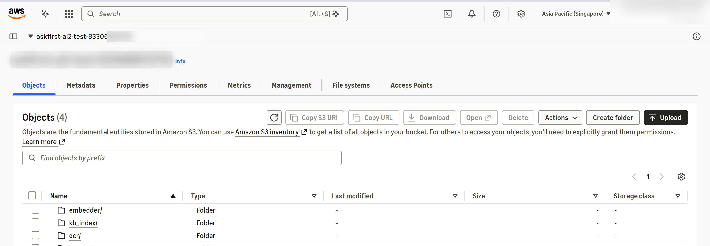

Lambda `ai` dùng bốn bộ file model. Chúng **không** nằm trong container image mà nằm trên S3. Khi Lambda khởi động, nó tải file về `/tmp/artifacts` và kiểm SHA-256 trước khi nạp.

Vì sao tách model khỏi image:

- Image nhẹ hơn khoảng 250 MB, build và push nhanh hơn.
- Đổi model (ví dụ index mới của knowledge base) chỉ cần upload lên S3 và đổi một dòng cấu hình, không phải build lại image.
- Mỗi bản model nằm ở một prefix có version, nên muốn quay lại bản cũ chỉ cần trỏ cấu hình về prefix cũ.

#### Bốn artifact và nơi định nghĩa

Nguồn sự thật duy nhất là `ai/config/artifacts.yaml`: tên, version, prefix trên S3 và SHA-256 của từng file.

| Artifact | Prefix trên S3 | Nội dung | Dung lượng |
|---|---|---|---|
| `ocr` | `ocr/ppocrv6-small-rapidocr3.10.0/` | RapidOCR: model tìm dòng chữ, đọc chữ, xoay chữ (ONNX fp32) | 32 MB |
| `vietocr` | `vietocr/vgg-seq2seq-0.3.13-fp32/` | VietOCR xuất sang ONNX: đọc lại các dòng tiếng Việt mà RapidOCR làm rơi chữ | 90 MB |
| `embedder` | `embedder/e5-small-qint8-614241f/` | `multilingual-e5-small` bản int8 để tạo vector cho RAG | 123 MB |
| `kb_index` | `kb_index/kb-2026.11.11/` | Vector của 21 thẻ kịch bản + 103 bài cảnh báo trong `kb/` | 0,3 MB |

#### Bước 1: Tạo bucket chứa model

```powershell
$env:AWS_PROFILE = "ai2test"; $env:AWS_DEFAULT_REGION = "ap-southeast-1"
$acct   = aws sts get-caller-identity --query Account --output text
$bucket = "askfirst-ai2-test-$acct"          # tên bucket là duy nhất toàn cầu, nên gắn account ID
aws s3 mb "s3://$bucket"
aws s3api get-public-access-block --bucket $bucket
```

Bucket mới tạo đã bật đủ 4 cờ Block Public Access; lệnh cuối phải in cả 4 giá trị `true`.

#### Bước 2: Tải và dựng file

Chạy trong thư mục `ai/`. Script `fetch_*` tự dừng nếu SHA-256 của file tải về khác `artifacts.yaml`.

```powershell
cd ai
uv run python scripts/fetch_ocr_models.py out/ocr
uv run python scripts/fetch_embedder.py out/embedder
uv run python scripts/build_index.py out/embedder out/kb_index --version kb-2026.11.11
```

Cuối lần chạy, `build_index.py` in mã băm của hai file index. Vector là số thực, nên chạy trên máy khác có thể lệch ở chữ số cuối và ra mã băm khác. Gặp trường hợp đó, chép mã băm của bạn vào mục `kb_index` của `artifacts.yaml` **trước** bước build image ở 5.5, vì file cấu hình này nằm trong image.

**VietOCR** cần PyTorch để xuất sang ONNX, nên dùng một môi trường Python riêng, tách khỏi môi trường của Lambda. Cách dựng môi trường ghi ở đầu `ai/scripts/export_vietocr_onnx.py`; sau đó:

```powershell
.venv-vietocr\Scripts\python scripts/export_vietocr_onnx.py out/vietocr
```

Script tải trọng số gốc, dừng nếu SHA-256 sai, và so từng phần của bản ONNX với PyTorch (sai số ≤ 1e-4) trước khi ghi file. Bỏ qua VietOCR cũng được: OCR vẫn chạy bằng RapidOCR, chỉ đọc kém chữ có dấu (xem bài học ở 5.11).

#### Bước 3: Upload có kiểm SHA-256

```powershell
$env:ARTIFACT_BUCKET = $bucket
uv run python scripts/upload_artifacts.py ocr out/ocr
uv run python scripts/upload_artifacts.py vietocr out/vietocr
uv run python scripts/upload_artifacts.py embedder out/embedder
uv run python scripts/upload_artifacts.py kb_index out/kb_index
```

Script kiểm **mọi file** của một artifact trước; chỉ cần một file lệch là không upload file nào. Kiểm lại:

```powershell
aws s3 ls "s3://$bucket/" --recursive --summarize --human-readable
```



#### Bước 4: Thử tải về như Lambda sẽ làm

Trước khi có Lambda, tôi chạy đúng lớp `S3ArtifactStore` mà Lambda dùng, ngay trên máy:

```powershell
uv run python -c "from pathlib import Path; from askfirst.artifacts.s3 import S3ArtifactStore as S; s=S('$bucket', Path('config/artifacts.yaml'), root=Path('out/dl')); [print(n, s.path(n)) for n in ('ocr','embedder','kb_index')]"
```

Kết quả đo ngày 19/11/2026 (từ máy ở Việt Nam): `ocr` 2,4 giây, `embedder` 5,9 giây, `kb_index` 0,4 giây. Chạy lần hai không tải lại gì vì file đã có và đúng SHA-256.

**Kiểm tra âm tính.** Tôi cố tình upload một `meta.json` lệch 1 byte rồi gọi lại: lớp này ném `ArtifactError: sai sha256` thay vì nạp file hỏng. Sau đó upload lại file đúng. Đây là lý do Lambda không bao giờ chạy với một model bị sửa hay bị tải dở.
