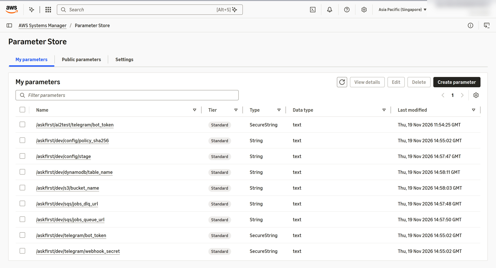
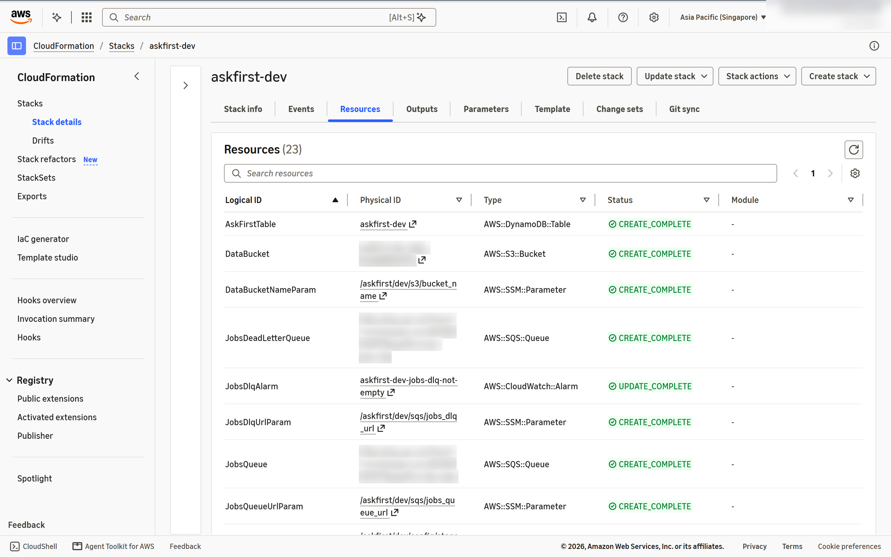
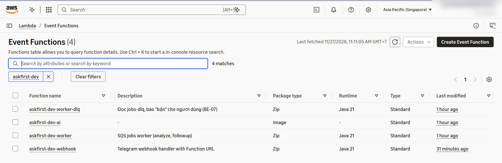

The `askfirst-dev` stack is described in `infra/template.yaml`. In this section we create the "ingestion and orchestration" part of the system. The `ai` Lambda is handled separately in 5.5.

| Created | Name on AWS | Notes |
|---|---|---|
| Lambda `webhook` (Java 21, Function URL) | `askfirst-dev-webhook` | Receives Telegram updates, checks the secret header |
| Lambda `worker` (Java 21, alias `live`) | `askfirst-dev-worker` | Reads jobs from SQS, invokes `ai`, sends results |
| Lambda `worker-dlq` (Java 21) | `askfirst-dev-worker-dlq` | Handles jobs that landed in the DLQ, notifies the user |
| DynamoDB table (PK/SK, GSI1, TTL, PITR, on-demand) | `askfirst-dev` | One table for every record type |
| SQS queue + DLQ | `askfirst-dev-jobs`, `askfirst-dev-jobs-dlq` | Visibility timeout of 720 seconds, moved to the DLQ after 5 attempts |
| S3 data bucket | `askfirst-dev-data-<ACCOUNT_ID>` | Public access blocked, encrypted, `donated/` auto-deleted after 30 days |
| CloudWatch alarm | `askfirst-dev-jobs-dlq-not-empty` | Fires when the DLQ has a job |
| SSM configuration parameters | `/askfirst/dev/...` | Table name, queue URL, bucket name |

#### Step 1: Create the secrets in SSM before deploying

The template does not create secrets; you create them manually so their values never appear in the template. Enter the token via `Read-Host` so it does not end up in the PowerShell history:

```powershell
$env:AWS_PROFILE = "ai2test"; $env:AWS_DEFAULT_REGION = "ap-southeast-1"

$t = Read-Host "Telegram bot token"
aws ssm put-parameter --name /askfirst/dev/telegram/bot_token --type SecureString --value $t --overwrite
Remove-Variable t

# webhook secret: random string containing only A-Z a-z 0-9 _ -
$s = -join ((48..57 + 65..90 + 97..122) | Get-Random -Count 48 | ForEach-Object { [char]$_ })
aws ssm put-parameter --name /askfirst/dev/telegram/webhook_secret --type SecureString --value $s --overwrite
Remove-Variable s
```

The template also reads the hash of the privacy policy **at deploy time** (`{{resolve:ssm:...}}`), so this parameter must exist beforehand as well:

```powershell
$sha = (Get-FileHash -Algorithm SHA256 docs/privacy-policy.md).Hash.ToLower()
aws ssm put-parameter --name /askfirst/dev/config/policy_sha256 --type String --value $sha --overwrite
```

This hash is the "version" of the terms the user consents to in the bot. Changing the policy file changes the hash, and the bot will ask users to consent again.



#### Step 2: Create an SNS topic for the alarm

An alarm with no recipient is useless: in my first test, the DLQ alarm transitioned to `ALARM` but nobody knew because `AlarmActions` was empty. Create the topic and subscribe an email first:

```powershell
$topic = aws sns create-topic --name askfirst-dev-alarms --query TopicArn --output text
aws sns subscribe --topic-arn $topic --protocol email --notification-endpoint <YOUR_EMAIL>
```

Open the email and click **Confirm subscription**, otherwise SNS will not send anything.

#### Step 3: Build the 3 Java Lambda functions

SAM builds each Java function independently, so the `common` module must first be `install`ed into the local Maven repository (`~/.m2`):

```powershell
cd backend\ScamProtection
.\mvnw.cmd clean install -DskipTests      # about 30 seconds, must end with BUILD SUCCESS
cd ..\..
```

If Maven is not installed, create an `mvn` shim for SAM (once):

```powershell
New-Item -ItemType Directory "$env:TEMP\mvnshim" -Force | Out-Null
Set-Content "$env:TEMP\mvnshim\mvn.cmd" "@echo off`r`ncall `"$PWD\backend\ScamProtection\mvnw.cmd`" %*"
$env:PATH = "$env:TEMP\mvnshim;$env:PATH"
```

#### Step 4: Build and deploy the stack

```powershell
cd infra
sam build                                  # 1–2 minutes, must end with Build Succeeded

$tok = aws ssm get-parameter --name /askfirst/dev/telegram/bot_token --with-decryption --query Parameter.Value --output text
sam deploy --parameter-overrides Stage=dev `
  TelegramBotUsername=askfirst_ai2_test_bot `
  "TelegramBotToken=$tok" `
  "AlarmTopicArn=$topic"
Remove-Variable tok
```

- The stack name, Region, and `CAPABILITY_IAM` are already set in `infra/samconfig.toml`.
- `TelegramBotToken` is a `NoEcho` parameter: CloudFormation shows `****` instead of the value. **It must be passed again on every redeploy**, otherwise `worker` loses the token (the default value is an empty string).
- `--parameter-overrides` on the command line completely replaces the `parameter_overrides` line in `samconfig.toml`, so always pass the full set of parameters.
- `No changes to deploy` means there is nothing new in the code; it is not an error.



#### Step 5: Quick verification with the CLI

```powershell
# Stack outputs
aws cloudformation describe-stacks --stack-name askfirst-dev `
  --query "Stacks[0].Outputs[].[OutputKey,OutputValue]" --output table

# DynamoDB: both TTL and PITR enabled
aws dynamodb describe-time-to-live --table-name askfirst-dev
aws dynamodb describe-continuous-backups --table-name askfirst-dev `
  --query "ContinuousBackupsDescription.PointInTimeRecoveryDescription.PointInTimeRecoveryStatus"

# SQS: 720 seconds and moved to the DLQ after 5 attempts
$q = aws ssm get-parameter --name /askfirst/dev/sqs/jobs_queue_url --query Parameter.Value --output text
aws sqs get-queue-attributes --queue-url $q --attribute-names VisibilityTimeout RedrivePolicy

# Alarm wired to SNS
aws cloudwatch describe-alarms --alarm-names askfirst-dev-jobs-dlq-not-empty `
  --query "MetricAlarms[0].[StateValue,AlarmActions]"
```

The stack has 14 output keys; those used in later sections are `WebhookFunctionUrl` (5.6), `WorkerRoleArn` and `JobsDlqUrl` (5.7).



#### When the deployment fails

| Symptom | Resolution |
|---|---|
| `sam build` reports that `mvn` cannot be found | The shim from step 3 is not on `PATH`, or you are running in Git Bash. Rerun in PowerShell. |
| Error resolving `policy_sha256` | The parameter from step 1 was not created, or was created in the wrong Region. |
| Stack in `ROLLBACK_COMPLETE` after the first deployment | CloudFormation locks the stack in this state. Delete the stack (empty the `askfirst-dev-data-...` bucket first, then run `sam delete --stack-name askfirst-dev`), fix the error, and deploy from scratch. |
| Viewing why a resource failed | `aws cloudformation describe-stack-events --stack-name askfirst-dev --query "StackEvents[?ResourceStatus=='CREATE_FAILED'].[LogicalResourceId,ResourceStatusReason]" --output table` |
