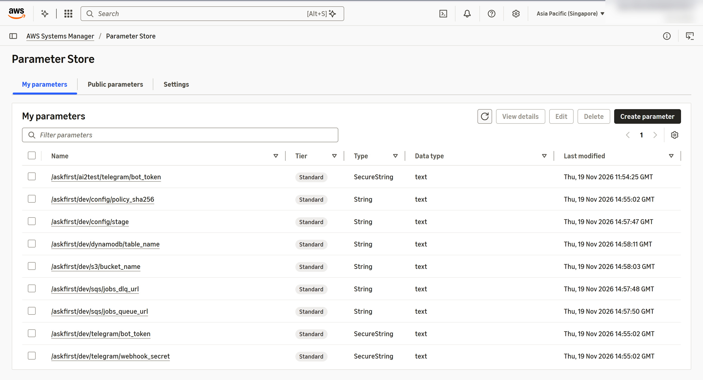
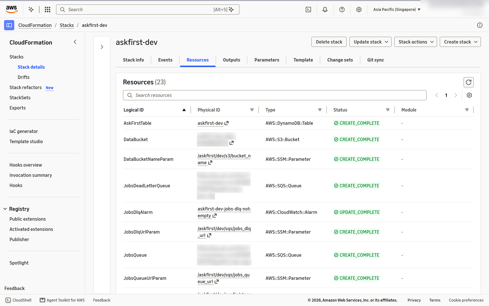
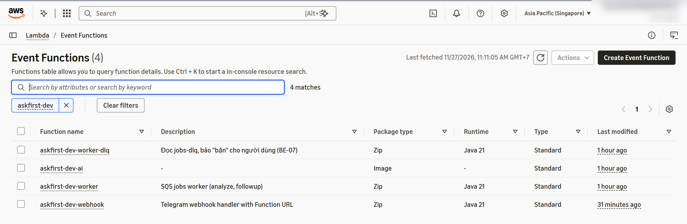

Stack `askfirst-dev` được mô tả trong `infra/template.yaml`. Ở mục này ta tạo phần "nhận và điều phối" của hệ thống. Lambda `ai` được làm riêng ở 5.5.

| Tạo ra | Tên trên AWS | Ghi chú |
|---|---|---|
| Lambda `webhook` (Java 21, Function URL) | `askfirst-dev-webhook` | Nhận update của Telegram, kiểm header secret |
| Lambda `worker` (Java 21, alias `live`) | `askfirst-dev-worker` | Đọc job từ SQS, gọi `ai`, gửi kết quả |
| Lambda `worker-dlq` (Java 21) | `askfirst-dev-worker-dlq` | Xử lý job đã vào DLQ, báo người dùng |
| Bảng DynamoDB (PK/SK, GSI1, TTL, PITR, on-demand) | `askfirst-dev` | Một bảng cho mọi loại bản ghi |
| SQS queue + DLQ | `askfirst-dev-jobs`, `askfirst-dev-jobs-dlq` | Visibility timeout 720 giây, vào DLQ sau 5 lần |
| S3 bucket dữ liệu | `askfirst-dev-data-<ACCOUNT_ID>` | Chặn public, mã hoá, `donated/` tự xoá sau 30 ngày |
| CloudWatch alarm | `askfirst-dev-jobs-dlq-not-empty` | Báo khi DLQ có job |
| Tham số SSM cấu hình | `/askfirst/dev/...` | Tên bảng, URL queue, tên bucket |

#### Bước 1: Tạo secret trong SSM trước khi deploy

Template không tạo secret; bạn tạo bằng tay để giá trị không bao giờ nằm trong template. Nhập token qua `Read-Host` để nó không vào lịch sử PowerShell:

```powershell
$env:AWS_PROFILE = "ai2test"; $env:AWS_DEFAULT_REGION = "ap-southeast-1"

$t = Read-Host "Telegram bot token"
aws ssm put-parameter --name /askfirst/dev/telegram/bot_token --type SecureString --value $t --overwrite
Remove-Variable t

# webhook secret: chuỗi ngẫu nhiên chỉ gồm A-Z a-z 0-9 _ -
$s = -join ((48..57 + 65..90 + 97..122) | Get-Random -Count 48 | ForEach-Object { [char]$_ })
aws ssm put-parameter --name /askfirst/dev/telegram/webhook_secret --type SecureString --value $s --overwrite
Remove-Variable s
```

Template còn đọc mã băm của chính sách quyền riêng tư **ngay lúc deploy** (`{{resolve:ssm:...}}`), nên tham số này cũng phải có trước:

```powershell
$sha = (Get-FileHash -Algorithm SHA256 docs/privacy-policy.md).Hash.ToLower()
aws ssm put-parameter --name /askfirst/dev/config/policy_sha256 --type String --value $sha --overwrite
```

Mã băm này là "phiên bản" của điều khoản mà người dùng đồng ý trong bot. Đổi file chính sách thì mã băm đổi, và bot sẽ hỏi người dùng đồng ý lại.



#### Bước 2: Tạo SNS topic cho alarm

Alarm không có ai nhận thì vô ích: lần test đầu, alarm DLQ của tôi chuyển sang `ALARM` nhưng không ai biết vì `AlarmActions` rỗng. Tạo topic và đăng ký email trước:

```powershell
$topic = aws sns create-topic --name askfirst-dev-alarms --query TopicArn --output text
aws sns subscribe --topic-arn $topic --protocol email --notification-endpoint <EMAIL_CUA_BAN>
```

Mở email và bấm **Confirm subscription**, nếu không SNS sẽ không gửi gì.

#### Bước 3: Build 3 Lambda Java

Mỗi function Java được SAM build độc lập, nên trước đó phải `install` module `common` vào kho Maven cục bộ (`~/.m2`):

```powershell
cd backend\ScamProtection
.\mvnw.cmd clean install -DskipTests      # khoảng 30 giây, phải kết thúc bằng BUILD SUCCESS
cd ..\..
```

Máy không cài Maven thì tạo shim `mvn` cho SAM (một lần):

```powershell
New-Item -ItemType Directory "$env:TEMP\mvnshim" -Force | Out-Null
Set-Content "$env:TEMP\mvnshim\mvn.cmd" "@echo off`r`ncall `"$PWD\backend\ScamProtection\mvnw.cmd`" %*"
$env:PATH = "$env:TEMP\mvnshim;$env:PATH"
```

#### Bước 4: Build và deploy stack

```powershell
cd infra
sam build                                  # 1–2 phút, phải kết thúc bằng Build Succeeded

$tok = aws ssm get-parameter --name /askfirst/dev/telegram/bot_token --with-decryption --query Parameter.Value --output text
sam deploy --parameter-overrides Stage=dev `
  TelegramBotUsername=askfirst_ai2_test_bot `
  "TelegramBotToken=$tok" `
  "AlarmTopicArn=$topic"
Remove-Variable tok
```

- Tên stack, Region, `CAPABILITY_IAM` đã có trong `infra/samconfig.toml`.
- `TelegramBotToken` là tham số `NoEcho`: CloudFormation hiện `****` thay vì giá trị. **Mỗi lần deploy lại phải truyền lại**, nếu không `worker` mất token (giá trị mặc định là chuỗi rỗng).
- `--parameter-overrides` trên dòng lệnh thay hẳn dòng `parameter_overrides` trong `samconfig.toml`, nên luôn truyền đủ bộ tham số.
- `No changes to deploy` nghĩa là code không có gì mới, không phải lỗi.



#### Bước 5: Kiểm tra nhanh bằng CLI

```powershell
# Output của stack
aws cloudformation describe-stacks --stack-name askfirst-dev `
  --query "Stacks[0].Outputs[].[OutputKey,OutputValue]" --output table

# DynamoDB: TTL và PITR đều bật
aws dynamodb describe-time-to-live --table-name askfirst-dev
aws dynamodb describe-continuous-backups --table-name askfirst-dev `
  --query "ContinuousBackupsDescription.PointInTimeRecoveryDescription.PointInTimeRecoveryStatus"

# SQS: 720 giây và chuyển DLQ sau 5 lần
$q = aws ssm get-parameter --name /askfirst/dev/sqs/jobs_queue_url --query Parameter.Value --output text
aws sqs get-queue-attributes --queue-url $q --attribute-names VisibilityTimeout RedrivePolicy

# Alarm đã gắn SNS
aws cloudwatch describe-alarms --alarm-names askfirst-dev-jobs-dlq-not-empty `
  --query "MetricAlarms[0].[StateValue,AlarmActions]"
```

Output của stack có 14 khoá; các khoá dùng ở mục sau là `WebhookFunctionUrl` (5.6), `WorkerRoleArn` và `JobsDlqUrl` (5.7).



#### Khi deploy lỗi

| Hiện tượng | Cách xử lý |
|---|---|
| `sam build` báo không tìm thấy `mvn` | Chưa đưa shim ở bước 3 lên `PATH`, hoặc đang chạy trong Git Bash. Chạy lại trong PowerShell. |
| Lỗi resolve `policy_sha256` | Chưa tạo tham số ở bước 1, hoặc tạo nhầm Region. |
| Stack ở `ROLLBACK_COMPLETE` sau lần đầu | CloudFormation khoá stack ở trạng thái này. Xoá stack (làm rỗng bucket `askfirst-dev-data-...` trước, rồi `sam delete --stack-name askfirst-dev`), khắc phục lỗi, deploy từ đầu. |
| Xem lý do một tài nguyên lỗi | `aws cloudformation describe-stack-events --stack-name askfirst-dev --query "StackEvents[?ResourceStatus=='CREATE_FAILED'].[LogicalResourceId,ResourceStatusReason]" --output table` |
