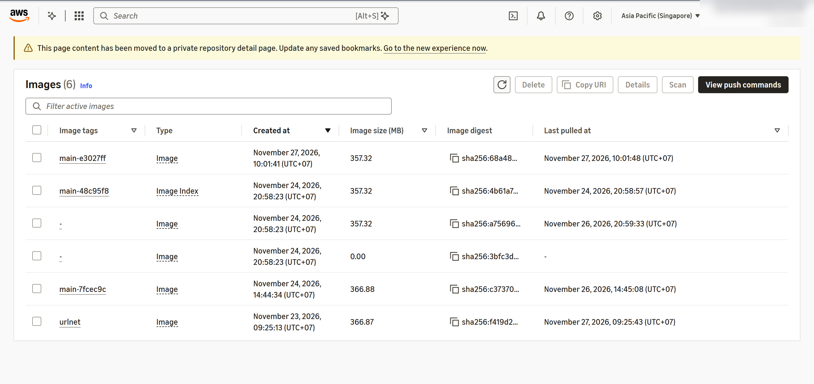
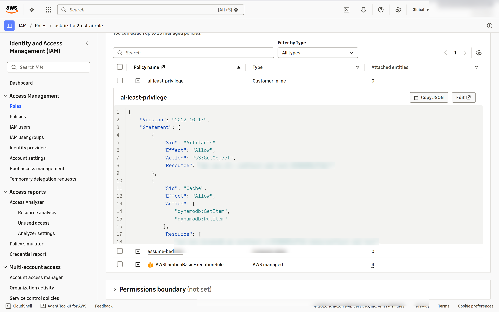
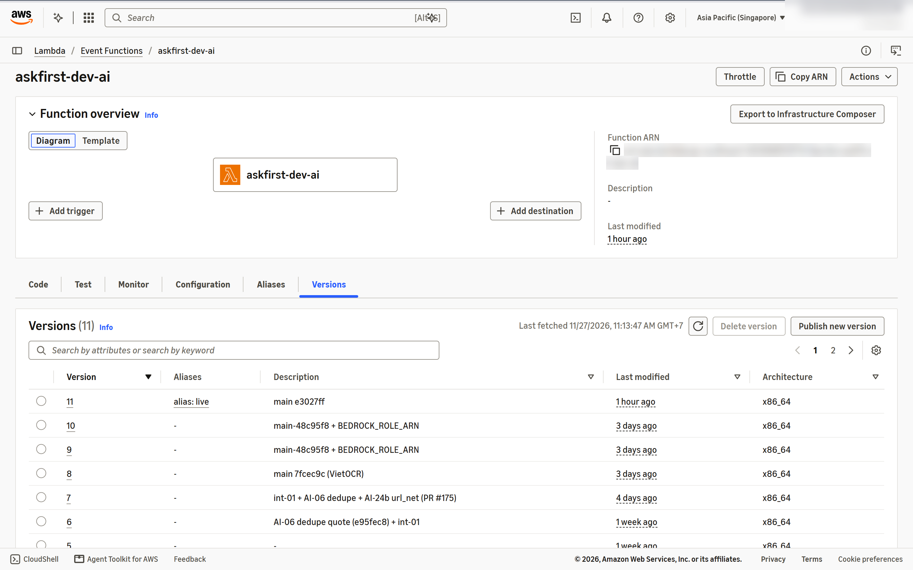

The `ai` Lambda is the heaviest part: Python 3.12, ONNX Runtime, RapidOCR, sentencepiece, boto3. In this section we build the image ourselves with Docker locally, push it to ECR, and then create the function with the AWS CLI using a least-privilege role. This is exactly how the team's shared environment runs: `worker` invokes `askfirst-dev-ai:live` by name, so this function does not need to be part of the SAM stack.

{}
`infra/template.yaml` also contains an `ai` function (only created when the `AiImageUri` parameter is passed). If you want everything in a single stack, after step 2 you can run `sam deploy` with `AiImageUri=<image URI>` in place of steps 3–5. I chose to create it with the CLI to keep control over versions and aliases while testing each revision of the AI part.
{}

#### Step 1: Create the ECR repository

```powershell
$env:AWS_PROFILE = "ai2test"; $env:AWS_DEFAULT_REGION = "ap-southeast-1"
$acct = aws sts get-caller-identity --query Account --output text
$reg  = "$acct.dkr.ecr.ap-southeast-1.amazonaws.com"
aws ecr create-repository --repository-name askfirst-dev-ai --image-scanning-configuration scanOnPush=true
aws ecr get-login-password | docker login -u AWS --password-stdin $reg
```

The ECR login token expires after 12 hours; if a push fails with `no basic auth credentials`, rerun the last line.

#### Step 2: Build the image and push it to ECR

Start Docker Desktop first. Build from the **repo root**, because the image needs `kb/` and `prompts/`, not just `ai/`:

```powershell
$sha = git rev-parse --short HEAD
$img = "${reg}/askfirst-dev-ai:main-$sha"
docker build --platform linux/amd64 --provenance=false -f ai/Dockerfile -t $img .
docker push $img
```

Three points in `ai/Dockerfile` that I had to fix when building the first version:

| Point | Reason |
|---|---|
| Keep the repo's directory tree under `/var/task` (`ai/src`, `ai/config`, `kb`, `prompts`) | The code locates `prompts/` and `config/models.yaml` via paths relative to the `.py` file. Installing the package into `site-packages` makes these two folders "disappear" at runtime. |
| `--platform linux/amd64` | The embedder is an int8 build optimized for x86; arm64 has not been measured. |
| `--provenance=false` | Recent Docker versions push attestations as a manifest list, which Lambda does not accept. |

The first build takes about 15 minutes (the image is about 1.4 GB); subsequent builds take 1–4 minutes thanks to the cache, since usually only the `ai/src` layer changes.



#### Step 3: Create a least-privilege IAM role

The `ai` role only needs to: write logs, **read** the model bucket, **read/write** a few cache keys in the table, **read** exactly one SSM parameter (the bot token, to download images from Telegram itself), and call Bedrock.

```powershell
$trust = '{"Version":"2012-10-17","Statement":[{"Effect":"Allow","Principal":{"Service":"lambda.amazonaws.com"},"Action":"sts:AssumeRole"}]}'
aws iam create-role --role-name askfirst-ai2test-ai-role --assume-role-policy-document $trust
aws iam attach-role-policy --role-name askfirst-ai2test-ai-role `
  --policy-arn arn:aws:iam::aws:policy/service-role/AWSLambdaBasicExecutionRole
aws iam put-role-policy --role-name askfirst-ai2test-ai-role --policy-name ai-least-privilege `
  --policy-document file://ai-policy.json
```

Contents of `ai-policy.json` (replace `<ACCOUNT_ID>`):

```json
{
  "Version": "2012-10-17",
  "Statement": [
    { "Sid": "Artifacts", "Effect": "Allow", "Action": "s3:GetObject",
      "Resource": "arn:aws:s3:::askfirst-ai2-test-<ACCOUNT_ID>/*" },
    { "Sid": "Cache", "Effect": "Allow", "Action": ["dynamodb:GetItem", "dynamodb:PutItem"],
      "Resource": "arn:aws:dynamodb:ap-southeast-1:<ACCOUNT_ID>:table/askfirst-dev" },
    { "Sid": "BotToken", "Effect": "Allow", "Action": "ssm:GetParameter",
      "Resource": "arn:aws:ssm:ap-southeast-1:<ACCOUNT_ID>:parameter/askfirst/dev/telegram/bot_token" },
    { "Sid": "Bedrock", "Effect": "Allow", "Action": ["bedrock:InvokeModel", "bedrock:ApplyGuardrail"],
      "Resource": ["arn:aws:bedrock:ap-southeast-2::foundation-model/qwen.qwen3-32b-v1:0",
                   "arn:aws:bedrock:ap-southeast-2::foundation-model/openai.gpt-oss-120b-1:0",
                   "arn:aws:bedrock:ap-southeast-2:<ACCOUNT_ID>:guardrail/*"] }
  ]
}
```

The role has no `s3:PutObject`, no `dynamodb:Scan`/`DeleteItem`, and cannot read any other SSM parameter. The token is encrypted with the AWS managed key `alias/aws/ssm`; this key allows decryption through SSM, so no additional `kms:Decrypt` is needed.

{}
In the team's environment, Bedrock is in a different account, so the `Bedrock` statement is replaced with `sts:AssumeRole` on that account's `askfirst-bedrock-from-team` role, and the function has an extra `BEDROCK_ROLE_ARN` variable. When working in a single account, use the policy above as is.
{}



#### Step 4: Create the function

```powershell
aws lambda create-function --function-name askfirst-dev-ai `
  --package-type Image --code ImageUri=$img `
  --role "arn:aws:iam::${acct}:role/askfirst-ai2test-ai-role" `
  --architectures x86_64 --memory-size 3008 --timeout 90 --ephemeral-storage Size=1024 `
  --environment "Variables={PIPELINE_IMPL=real,ARTIFACT_BUCKET=askfirst-ai2-test-$acct,TABLE_NAME=askfirst-dev,BOT_TOKEN_PARAM=/askfirst/dev/telegram/bot_token}"
aws lambda wait function-active-v2 --function-name askfirst-dev-ai
```

Why these numbers:

| Setting | Value | Reason |
|---|---|---|
| Memory | 3008 MB | Lambda allocates CPU proportionally to memory (about 1,769 MB = 1 vCPU). I measured 3 settings: 1769 MB made the INIT phase hit the 10-second limit, 2048 MB had a 7.1-second INIT, 3008 MB had a 6.2-second INIT. Actual RAM usage is only about 0.8–1 GB; what is needed is CPU. |
| Timeout | 90 seconds | `worker` has a 120-second timeout and still has to send the Telegram message after `ai` responds. |
| Ephemeral storage | 1024 MB | The models downloaded to `/tmp/artifacts` total about 250 MB. |
| `PIPELINE_IMPL=real` | | Runs the real pipeline; `stub` only replies based on keywords, used to keep the bot working when the pipeline is broken. |

#### Step 5: Publish a version and create the `live` alias

`worker` always invokes `askfirst-dev-ai:live`. The alias lets you switch the running version (or roll back) without touching `worker`:

```powershell
$v = aws lambda publish-version --function-name askfirst-dev-ai --description "main $sha" --query Version --output text
aws lambda create-alias --function-name askfirst-dev-ai --name live --function-version $v
```

**Updating to a new version** (whenever `main` has changes in the AI part):

```powershell
aws lambda update-function-code --function-name askfirst-dev-ai --image-uri $img
aws lambda wait function-updated-v2 --function-name askfirst-dev-ai
$v = aws lambda publish-version --function-name askfirst-dev-ai --description "main $sha" --query Version --output text
aws lambda get-function-configuration --function-name askfirst-dev-ai --qualifier $v --query State   # wait for "Active"
aws lambda update-alias --function-name askfirst-dev-ai --name live --function-version $v
```

**Rolling back:** `aws lambda update-alias --function-name askfirst-dev-ai --name live --function-version <OLD_VERSION>`. This only works while the old version's image is still in ECR, so do not delete the image of any version you might need to roll back to.



#### Step 6: Test-invoke with a sample request

`contracts/fixtures/` contains the sample requests that CI also uses. Take the `request` part of the OTP case and invoke the `live` alias:

```powershell
(Get-Content contracts/fixtures/analyze/otp.json -Raw | ConvertFrom-Json).request |
  ConvertTo-Json -Depth 20 | Set-Content -Encoding utf8 payload.json
aws lambda invoke --function-name askfirst-dev-ai:live `
  --cli-binary-format raw-in-base64-out --payload fileb://payload.json out.json
Get-Content out.json
```

You should see `"StatusCode": 200`, and `out.json` should contain `"op": "analyze"` with risk level `DANGEROUS` for the message "Gửi mã OTP cho tôi" ("Send me the OTP code"). The first invocation is a cold start, so it is much slower than subsequent ones (measurements in 5.7).

Check the startup logs to make sure all three models were preloaded during the INIT phase:

```powershell
aws logs tail /aws/lambda/askfirst-dev-ai --since 15m --format short | Select-String "rag_warm|ocr_warm|vietocr_warm|Init Duration"
```

You must see `rag_warm`, `ocr_warm`, and `vietocr_warm`, all with status `ok`.
