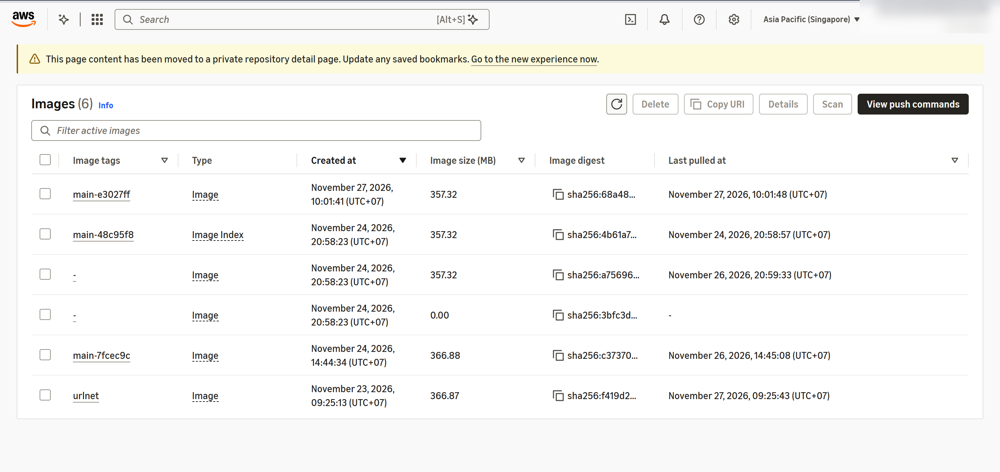
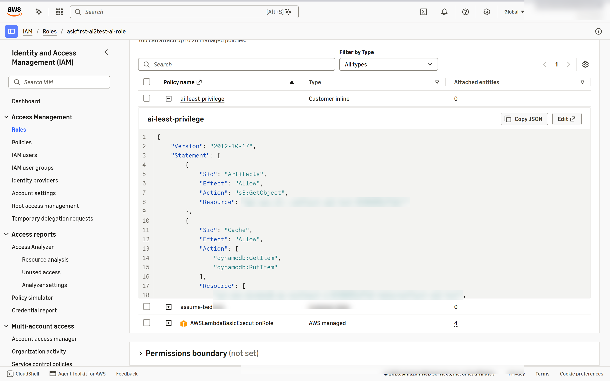
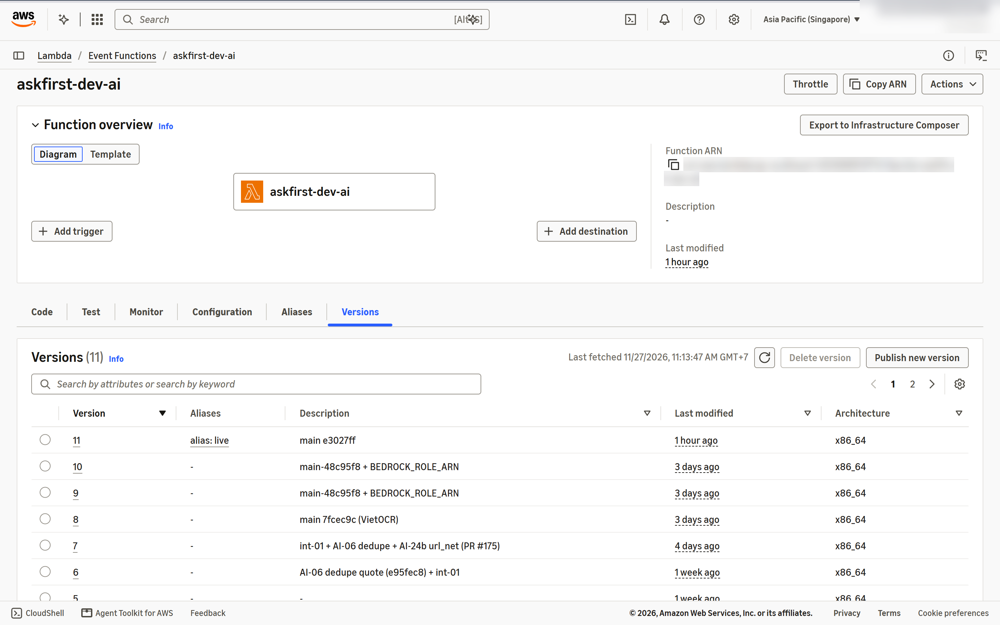

Lambda `ai` là phần nặng nhất: Python 3.12, ONNX Runtime, RapidOCR, sentencepiece, boto3. Ở mục này ta tự build image bằng Docker trên máy, đẩy lên ECR, rồi tạo function bằng AWS CLI với role quyền tối thiểu. Đây đúng là cách môi trường chạy chung của nhóm đang chạy: `worker` gọi `askfirst-dev-ai:live` theo tên, nên function này không cần nằm trong stack SAM.

{}
`infra/template.yaml` cũng có sẵn function `ai` (chỉ tạo khi truyền tham số `AiImageUri`). Nếu muốn mọi thứ nằm trong một stack, sau bước 2 bạn có thể `sam deploy` thêm `AiImageUri=<URI image>` thay cho bước 3–5. Tôi chọn tạo bằng CLI để chủ động version và alias khi thử từng bản sửa của phần AI.
{}

#### Bước 1: Tạo ECR repository

```powershell
$env:AWS_PROFILE = "ai2test"; $env:AWS_DEFAULT_REGION = "ap-southeast-1"
$acct = aws sts get-caller-identity --query Account --output text
$reg  = "$acct.dkr.ecr.ap-southeast-1.amazonaws.com"
aws ecr create-repository --repository-name askfirst-dev-ai --image-scanning-configuration scanOnPush=true
aws ecr get-login-password | docker login -u AWS --password-stdin $reg
```

Token đăng nhập ECR hết hạn sau 12 giờ; push lỗi `no basic auth credentials` thì chạy lại dòng cuối.

#### Bước 2: Build image và đẩy lên ECR

Bật Docker Desktop trước. Build từ **gốc repo**, vì image cần cả `kb/` và `prompts/` chứ không chỉ `ai/`:

```powershell
$sha = git rev-parse --short HEAD
$img = "${reg}/askfirst-dev-ai:main-$sha"
docker build --platform linux/amd64 --provenance=false -f ai/Dockerfile -t $img .
docker push $img
```

Ba điểm trong `ai/Dockerfile` mà tôi đã phải sửa khi dựng bản đầu:

| Điểm | Lý do |
|---|---|
| Giữ nguyên cây thư mục repo dưới `/var/task` (`ai/src`, `ai/config`, `kb`, `prompts`) | Code tìm `prompts/` và `config/models.yaml` theo đường dẫn tương đối với file `.py`. Cài package vào `site-packages` làm hai thư mục này "biến mất" khi chạy. |
| `--platform linux/amd64` | Embedder là bản int8 tối ưu cho x86; arm64 chưa được đo. |
| `--provenance=false` | Docker bản mới đẩy kèm attestation dưới dạng manifest list, Lambda không nhận loại manifest này. |

Lần build đầu mất khoảng 15 phút (image khoảng 1,4 GB); các lần sau 1–4 phút nhờ cache, vì thường chỉ lớp `ai/src` thay đổi.



#### Bước 3: Tạo IAM role quyền tối thiểu

Role của `ai` chỉ cần: ghi log, **đọc** bucket model, **đọc/ghi** vài khoá cache trong bảng, **đọc** đúng một tham số SSM (bot token, để tự tải ảnh từ Telegram), và gọi Bedrock.

```powershell
$trust = '{"Version":"2012-10-17","Statement":[{"Effect":"Allow","Principal":{"Service":"lambda.amazonaws.com"},"Action":"sts:AssumeRole"}]}'
aws iam create-role --role-name askfirst-ai2test-ai-role --assume-role-policy-document $trust
aws iam attach-role-policy --role-name askfirst-ai2test-ai-role `
  --policy-arn arn:aws:iam::aws:policy/service-role/AWSLambdaBasicExecutionRole
aws iam put-role-policy --role-name askfirst-ai2test-ai-role --policy-name ai-least-privilege `
  --policy-document file://ai-policy.json
```

Nội dung `ai-policy.json` (thay `<ACCOUNT_ID>`):

```json
{
  "Version": "2012-10-17",
  "Statement": [
    { "Sid": "Artifacts", "Effect": "Allow", "Action": "s3:GetObject",
      "Resource": "arn:aws:s3:::askfirst-ai2-test-<ACCOUNT_ID>/*" },
    { "Sid": "Cache", "Effect": "Allow", "Action": ["dynamodb:GetItem", "dynamodb:PutItem"],
      "Resource": "arn:aws:dynamodb:ap-southeast-1:<ACCOUNT_ID>:table/askfirst-dev" },
    { "Sid": "BotToken", "Effect": "Allow", "Action": "ssm:GetParameter",
      "Resource": "arn:aws:ssm:ap-southeast-1:<ACCOUNT_ID>:parameter/askfirst/dev/telegram/bot_token" },
    { "Sid": "Bedrock", "Effect": "Allow", "Action": ["bedrock:InvokeModel", "bedrock:ApplyGuardrail"],
      "Resource": ["arn:aws:bedrock:ap-southeast-2::foundation-model/qwen.qwen3-32b-v1:0",
                   "arn:aws:bedrock:ap-southeast-2::foundation-model/openai.gpt-oss-120b-1:0",
                   "arn:aws:bedrock:ap-southeast-2:<ACCOUNT_ID>:guardrail/*"] }
  ]
}
```

Role không có `s3:PutObject`, không có `dynamodb:Scan`/`DeleteItem`, không đọc được tham số SSM nào khác. Token được mã hoá bằng khoá AWS quản lý `alias/aws/ssm`; khoá này cho phép giải mã qua SSM nên không cần thêm `kms:Decrypt`.

{}
Trên môi trường của nhóm, Bedrock ở tài khoản khác nên statement `Bedrock` được thay bằng `sts:AssumeRole` tới role `askfirst-bedrock-from-team` của tài khoản đó, và function có thêm biến `BEDROCK_ROLE_ARN`. Tự làm trong một tài khoản thì dùng đúng policy trên.
{}



#### Bước 4: Tạo function

```powershell
aws lambda create-function --function-name askfirst-dev-ai `
  --package-type Image --code ImageUri=$img `
  --role "arn:aws:iam::${acct}:role/askfirst-ai2test-ai-role" `
  --architectures x86_64 --memory-size 3008 --timeout 90 --ephemeral-storage Size=1024 `
  --environment "Variables={PIPELINE_IMPL=real,ARTIFACT_BUCKET=askfirst-ai2-test-$acct,TABLE_NAME=askfirst-dev,BOT_TOKEN_PARAM=/askfirst/dev/telegram/bot_token}"
aws lambda wait function-active-v2 --function-name askfirst-dev-ai
```

Vì sao các con số này:

| Cấu hình | Giá trị | Lý do |
|---|---|---|
| Memory | 3008 MB | Lambda cấp CPU theo memory (khoảng 1.769 MB = 1 vCPU). Tôi đo 3 mức: 1769 MB làm pha INIT chạm trần 10 giây, 2048 MB INIT 7,1 giây, 3008 MB INIT 6,2 giây. RAM dùng thật chỉ khoảng 0,8–1 GB; thứ cần là CPU. |
| Timeout | 90 giây | `worker` có timeout 120 giây và còn phải gửi tin Telegram sau khi `ai` trả lời. |
| Ephemeral storage | 1024 MB | Model tải về `/tmp/artifacts` tổng khoảng 250 MB. |
| `PIPELINE_IMPL=real` | | Chạy pipeline thật; `stub` chỉ trả lời theo từ khoá, dùng khi cần bot chạy thông lúc pipeline lỗi. |

#### Bước 5: Publish version và tạo alias `live`

`worker` luôn gọi `askfirst-dev-ai:live`. Alias giúp đổi bản đang chạy (hoặc quay lại bản cũ) mà không đụng tới `worker`:

```powershell
$v = aws lambda publish-version --function-name askfirst-dev-ai --description "main $sha" --query Version --output text
aws lambda create-alias --function-name askfirst-dev-ai --name live --function-version $v
```

**Cập nhật lên bản mới** (mỗi khi `main` có thay đổi ở phần AI):

```powershell
aws lambda update-function-code --function-name askfirst-dev-ai --image-uri $img
aws lambda wait function-updated-v2 --function-name askfirst-dev-ai
$v = aws lambda publish-version --function-name askfirst-dev-ai --description "main $sha" --query Version --output text
aws lambda get-function-configuration --function-name askfirst-dev-ai --qualifier $v --query State   # chờ "Active"
aws lambda update-alias --function-name askfirst-dev-ai --name live --function-version $v
```

**Quay lại bản cũ:** `aws lambda update-alias --function-name askfirst-dev-ai --name live --function-version <SỐ_CŨ>`. Chỉ làm được khi image của version cũ còn trong ECR, nên đừng xoá image của bản đang có thể cần quay về.



#### Bước 6: Gọi thử bằng request mẫu

`contracts/fixtures/` chứa request mẫu mà CI cũng dùng. Lấy phần `request` của ca OTP và gọi alias `live`:

```powershell
(Get-Content contracts/fixtures/analyze/otp.json -Raw | ConvertFrom-Json).request |
  ConvertTo-Json -Depth 20 | Set-Content -Encoding utf8 payload.json
aws lambda invoke --function-name askfirst-dev-ai:live `
  --cli-binary-format raw-in-base64-out --payload fileb://payload.json out.json
Get-Content out.json
```

Phải thấy `"StatusCode": 200`, và trong `out.json` có `"op": "analyze"`, mức rủi ro `DANGEROUS` cho tin "Gửi mã OTP cho tôi". Lần gọi đầu là cold start nên chậm hơn hẳn các lần sau (số đo ở 5.7).

Xem log khởi động để chắc chắn ba model đã được nạp sẵn ở pha INIT:

```powershell
aws logs tail /aws/lambda/askfirst-dev-ai --since 15m --format short | Select-String "rag_warm|ocr_warm|vietocr_warm|Init Duration"
```

Phải có đủ `rag_warm`, `ocr_warm`, `vietocr_warm` với trạng thái `ok`.
