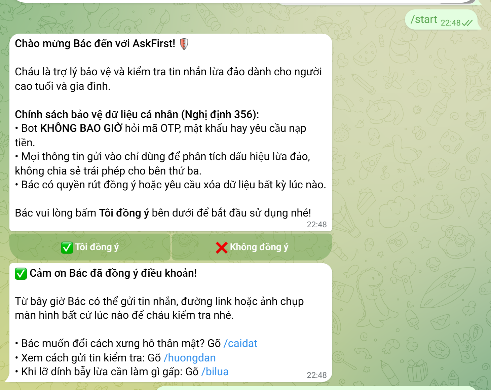
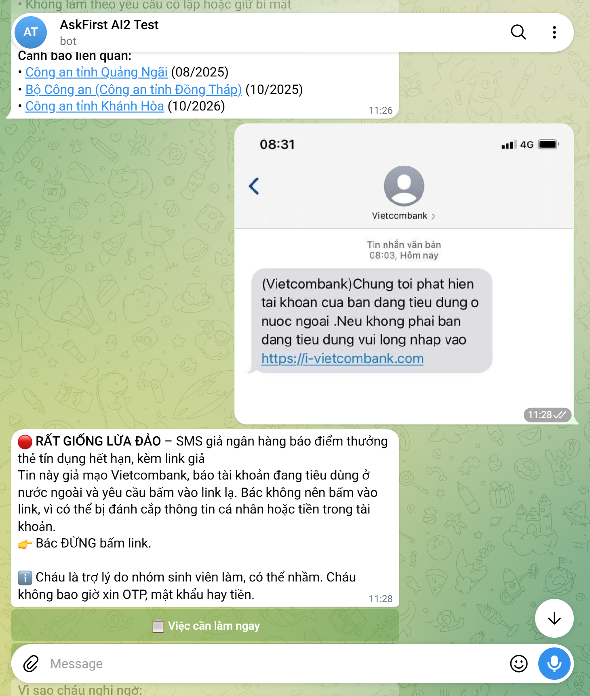

At this point every component is on AWS. What remains is to tell Telegram to send updates to the `webhook` Function URL, along with a secret known only to us and Telegram.

#### Step 1: Verify the webhook's protection before opening it to Telegram

The Function URL is public (`AuthType: NONE`): anyone who knows the URL can send requests. The protection lives in the code: any request without an `X-Telegram-Bot-Api-Secret-Token` header matching the secret in SSM is rejected. Test all three cases:

```powershell
$url = aws cloudformation describe-stacks --stack-name askfirst-dev `
  --query "Stacks[0].Outputs[?OutputKey=='WebhookFunctionUrl'].OutputValue" --output text
$sec = aws ssm get-parameter --name /askfirst/dev/telegram/webhook_secret --with-decryption `
  --query Parameter.Value --output text

curl.exe -s -o NUL -w "no secret:    %{http_code}`n" -X POST $url -H "Content-Type: application/json" -d "{}"
curl.exe -s -o NUL -w "wrong secret: %{http_code}`n" -X POST $url -H "Content-Type: application/json" -H "X-Telegram-Bot-Api-Secret-Token: wrong" -d "{}"
curl.exe -s -w " | right secret: %{http_code}`n" -X POST $url -H "Content-Type: application/json" -H "X-Telegram-Bot-Api-Secret-Token: $sec" -d "{}"
Remove-Variable sec
```

Results on my environment (27/11/2026):

```text
no secret:    401
wrong secret: 401
IGNORED | right secret: 200
```

`IGNORED` is correct: the secret is valid but the body is empty and not a Telegram update, so `webhook` ignores it.

#### Step 2: Register the webhook with Telegram

The `scripts/set_webhook.py` script calls `setWebhook` with the URL, the secret, and the list of update types to receive. Pass values through environment variables of the current window, not through a `.env` file:

```powershell
$env:TELEGRAM_BOT_TOKEN      = aws ssm get-parameter --name /askfirst/dev/telegram/bot_token --with-decryption --query Parameter.Value --output text
$env:TELEGRAM_WEBHOOK_SECRET = aws ssm get-parameter --name /askfirst/dev/telegram/webhook_secret --with-decryption --query Parameter.Value --output text
python scripts/set_webhook.py --url $url
python scripts/set_commands.py            # command menu: /batdau, /huongdan, /caidat, /nguoithan, /lichsu, /bilua
Remove-Item Env:TELEGRAM_BOT_TOKEN, Env:TELEGRAM_WEBHOOK_SECRET
```

The script refuses to run without a secret: a webhook without a secret lets anyone forge Telegram updates.

Verify on the Telegram side with `getWebhookInfo` (URL redacted):

```json
{
  "url": "https://<FUNCTION_URL>",
  "has_custom_certificate": false,
  "pending_update_count": 0,
  "max_connections": 40,
  "allowed_updates": ["message", "callback_query", "my_chat_member"]
}
```

A `pending_update_count` of 0 means Telegram has no updates waiting to be redelivered; this number grows when `webhook` returns errors. `my_chat_member` tells the bot when a user blocks it.

{}
The Function URL only changes when the stack is deleted and recreated. Redeploying code does **not** require re-registering the webhook.
{}

#### Step 3: Send the first message

1. Open the bot and send `/start`. The bot sends a greeting with the terms and a consent button. Under Vietnam's Personal Data Protection Law and Decree 356/2025/ND-CP (effective from 01/01/2026), consent must be verifiable, so the bot only processes messages after the user **actively** taps the consent button.
2. Tap consent.
3. Forward or type a suspected scam message. The bot replies "⏳" almost instantly, then edits that same message into the result.



![A text message impersonating the police and demanding a transfer to a "safe account" (27/11/2026): the bot answers "VERY LIKELY A SCAM", next steps, and reasons with quotes; the account number in the quote was masked as [STK_1] before reaching the LLM](/images/5-Workshop/5.6-Connect-Telegram/tg-text-result.png)



#### If the bot does not reply

| Symptom | Where to look |
|---|---|
| Not even a "⏳" | `getWebhookInfo`: `last_error_message` and `pending_update_count`. Logs in `/aws/lambda/askfirst-dev-webhook`. |
| "⏳" appears but no result | Logs in `/aws/lambda/askfirst-dev-worker`: look for `job_failed` or `invalid_job` lines. Depth of the `askfirst-dev-jobs` queue. |
| Text messages work, images fail | `ai` downloads images using the token read from `BOT_TOKEN_PARAM`. An old token or a wrong parameter breaks only images; text messages still work. |
| A result arrives but says "chỉ kiểm được dấu hiệu cơ bản" ("only basic signs could be checked") | The LLM is turned off (kill switch `llm_enabled=false`) or Bedrock is failing; the pipeline falls back to rules-only mode. |
