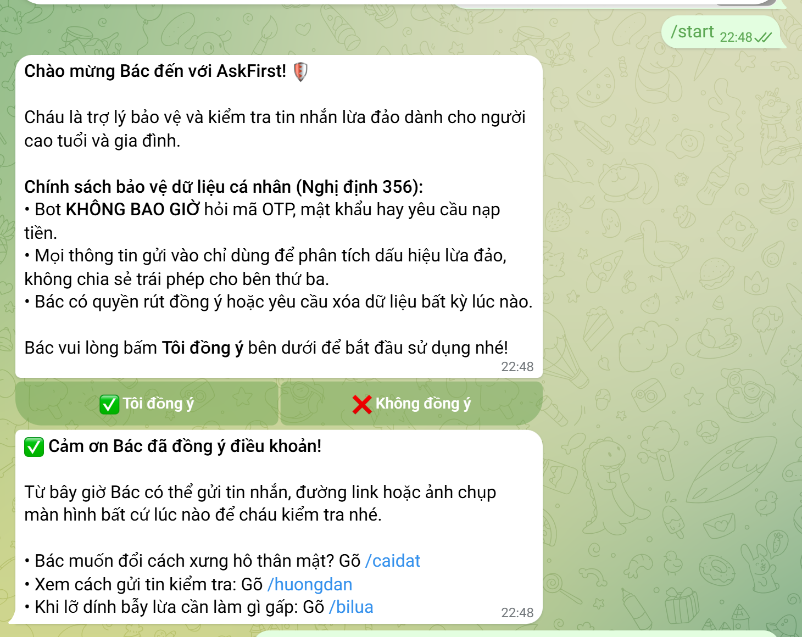
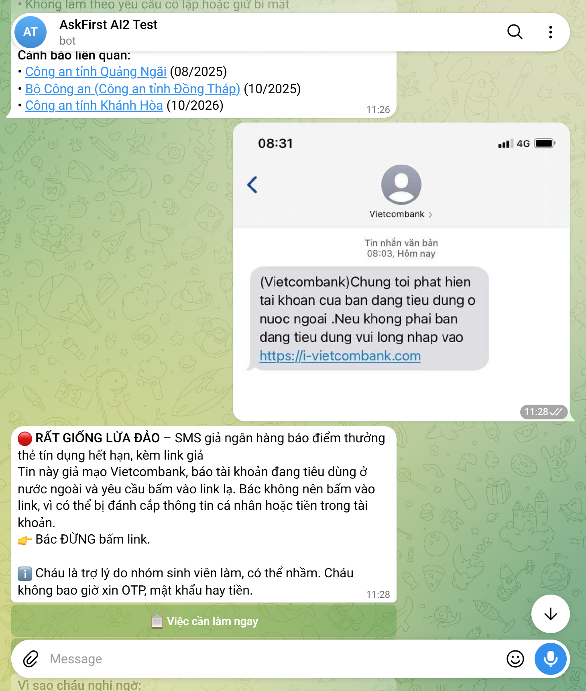

Đến đây mọi thành phần đã nằm trên AWS. Việc còn lại là bảo Telegram gửi update tới Function URL của `webhook`, kèm secret mà chỉ ta và Telegram biết.

#### Bước 1: Kiểm tra lớp bảo vệ của webhook trước khi mở cho Telegram

Function URL là công khai (`AuthType: NONE`): ai biết URL cũng gửi được request. Lớp bảo vệ nằm trong code: request nào không có header `X-Telegram-Bot-Api-Secret-Token` khớp với secret trong SSM đều bị từ chối. Kiểm tra cả ba trường hợp:

```powershell
$url = aws cloudformation describe-stacks --stack-name askfirst-dev `
  --query "Stacks[0].Outputs[?OutputKey=='WebhookFunctionUrl'].OutputValue" --output text
$sec = aws ssm get-parameter --name /askfirst/dev/telegram/webhook_secret --with-decryption `
  --query Parameter.Value --output text

curl.exe -s -o NUL -w "khong secret: %{http_code}`n" -X POST $url -H "Content-Type: application/json" -d "{}"
curl.exe -s -o NUL -w "sai secret:   %{http_code}`n" -X POST $url -H "Content-Type: application/json" -H "X-Telegram-Bot-Api-Secret-Token: wrong" -d "{}"
curl.exe -s -w " | dung secret: %{http_code}`n" -X POST $url -H "Content-Type: application/json" -H "X-Telegram-Bot-Api-Secret-Token: $sec" -d "{}"
Remove-Variable sec
```

Kết quả trên môi trường của tôi (27/11/2026):

```text
khong secret: 401
sai secret:   401
IGNORED | dung secret: 200
```

`IGNORED` là đúng: secret hợp lệ nhưng body rỗng, không phải update của Telegram, nên `webhook` bỏ qua.

#### Bước 2: Đăng ký webhook với Telegram

Script `scripts/set_webhook.py` gọi `setWebhook` với URL, secret và danh sách loại update cần nhận. Truyền giá trị qua biến môi trường của cửa sổ hiện tại, không ghi vào file `.env`:

```powershell
$env:TELEGRAM_BOT_TOKEN      = aws ssm get-parameter --name /askfirst/dev/telegram/bot_token --with-decryption --query Parameter.Value --output text
$env:TELEGRAM_WEBHOOK_SECRET = aws ssm get-parameter --name /askfirst/dev/telegram/webhook_secret --with-decryption --query Parameter.Value --output text
python scripts/set_webhook.py --url $url
python scripts/set_commands.py            # menu lệnh: /batdau, /huongdan, /caidat, /nguoithan, /lichsu, /bilua
Remove-Item Env:TELEGRAM_BOT_TOKEN, Env:TELEGRAM_WEBHOOK_SECRET
```

Script từ chối chạy nếu thiếu secret: webhook không có secret thì ai cũng giả được update của Telegram.

Kiểm tra lại phía Telegram bằng `getWebhookInfo` (URL đã che):

```json
{
  "url": "https://<FUNCTION_URL>",
  "has_custom_certificate": false,
  "pending_update_count": 0,
  "max_connections": 40,
  "allowed_updates": ["message", "callback_query", "my_chat_member"]
}
```

`pending_update_count` bằng 0 nghĩa là Telegram không có update nào đang chờ gửi lại; số này tăng dần khi `webhook` trả lỗi. `my_chat_member` cho bot biết khi người dùng chặn bot.

{}
URL của Function URL chỉ đổi khi stack bị xoá và tạo lại. Deploy lại code thì **không** cần đăng ký webhook lại.
{}

#### Bước 3: Nhắn tin đầu tiên

1. Mở bot, gửi `/start`. Bot gửi lời chào kèm điều khoản và nút đồng ý. Theo Luật Bảo vệ dữ liệu cá nhân và Nghị định 356/2025/NĐ-CP (hiệu lực từ 01/01/2026), sự đồng ý phải kiểm chứng được, nên bot chỉ xử lý tin sau khi người dùng **chủ động** bấm đồng ý.
2. Bấm đồng ý.
3. Chuyển tiếp hoặc gõ một tin nghi lừa đảo. Bot trả "⏳" gần như ngay lập tức, rồi sửa chính tin đó thành kết quả.



![Tin chữ giả danh công an đòi chuyển tiền vào "tài khoản an toàn" (27/11/2026): bot trả "RẤT GIỐNG LỪA ĐẢO", việc cần làm, và lý do kèm trích dẫn; số tài khoản trong trích dẫn đã bị che thành [STK_1] trước khi gửi tới LLM](/images/5-Workshop/5.6-Connect-Telegram/tg-text-result.png)



#### Nếu bot không trả lời

| Hiện tượng | Nơi cần xem |
|---|---|
| Không có cả "⏳" | `getWebhookInfo`: `last_error_message` và `pending_update_count`. Log `/aws/lambda/askfirst-dev-webhook`. |
| Có "⏳" nhưng không có kết quả | Log `/aws/lambda/askfirst-dev-worker`: tìm dòng `job_failed` hoặc `invalid_job`. Độ sâu queue `askfirst-dev-jobs`. |
| Tin chữ chạy, ảnh lỗi | `ai` tải ảnh bằng token đọc từ `BOT_TOKEN_PARAM`. Token cũ hoặc sai tham số thì chỉ ảnh hỏng, tin chữ vẫn chạy. |
| Có kết quả nhưng ghi "chỉ kiểm được dấu hiệu cơ bản" | LLM đang tắt (kill switch `llm_enabled=false`) hoặc Bedrock lỗi; pipeline rơi về chế độ chỉ chạy luật. |
