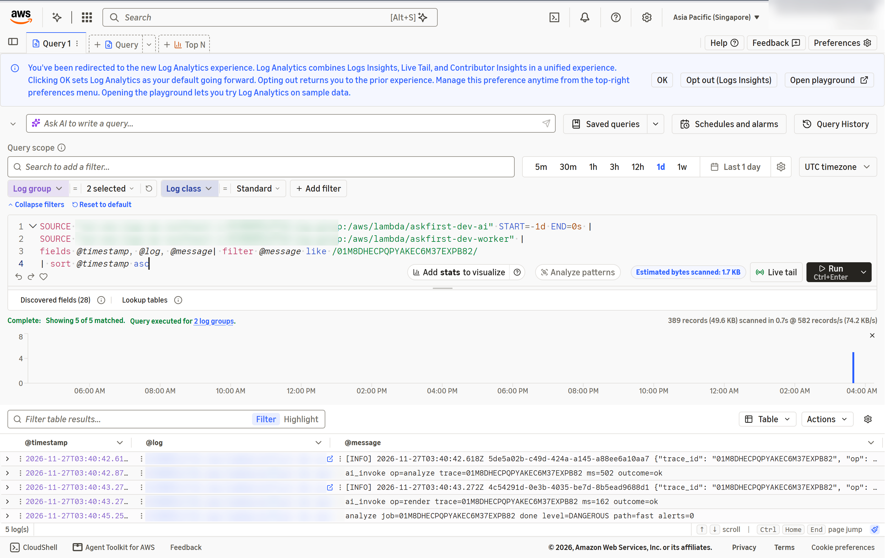
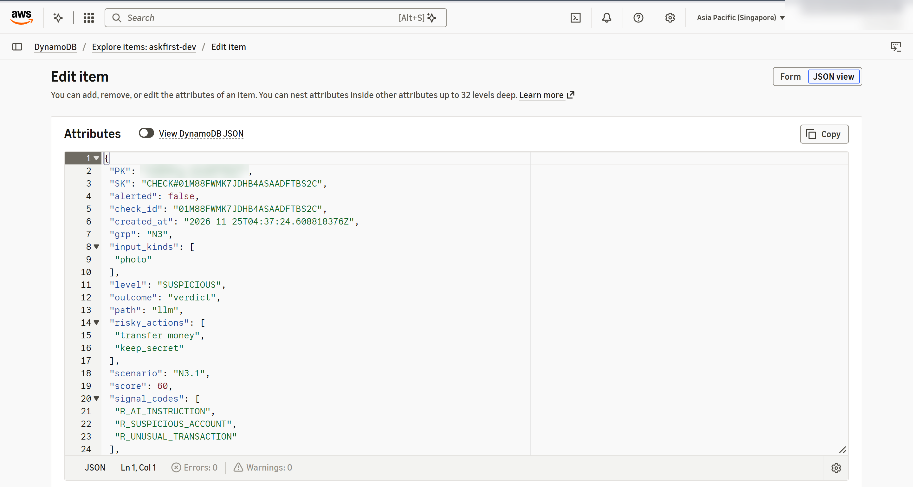

I test in three layers, from the inside out: invoke the `ai` Lambda directly with sample requests, send real messages through the bot, and then deliberately break a component to see how the system reacts.

#### 5.7.1 Invoking the `ai` Lambda directly with sample requests

The script below invokes the `live` alias with each request in `contracts/fixtures/` and reads the `REPORT` line from the returned log (`LogType=Tail`) to get the duration and memory usage:

```python
import base64, json, re, boto3, pathlib
lam = boto3.Session(profile_name="ai2test", region_name="ap-southeast-1").client("lambda")
fx = pathlib.Path("contracts/fixtures/analyze")
for name in ["otp", "default", "link", "smalltalk", "unreadable"]:
    req = json.loads((fx / f"{name}.json").read_text(encoding="utf-8"))["request"]
    r = lam.invoke(FunctionName="askfirst-dev-ai:live", Payload=json.dumps(req).encode(), LogType="Tail")
    body = json.loads(r["Payload"].read())
    report = re.search(r"Duration: ([\d.]+) ms.*Max Memory Used: (\d+) MB", base64.b64decode(r["LogResult"]).decode(), re.S)
    v = body["analyze"]["verdict"]
    print(name, v["level"], v["path"], report.groups())
```

Results from 27/11/2026 on the latest version (commit `e3027ff`, LLM enabled):

| Request | Risk level | Processing path | Lambda duration | Notes |
|---|---|---|---|---|
| `otp` ("Gửi mã OTP cho tôi" — "Send me the OTP code"), **cold start** | `DANGEROUS` | `llm` | INIT 8.7 s + 2.4 s | First invocation after a period of inactivity |
| `default` (greeting message) | `LOW_RISK` | `escalated` | 4.1 s | Rules not confident enough; the judge also consulted the fallback model |
| `link` (message with a link) | `SUSPICIOUS` | `escalated` | 10.5 s | Includes probing the shortened link |
| `smalltalk` | `LOW_RISK` | `fast` | 11 ms | No LLM call |
| `unreadable` | `UNSURE` | `fast` | 10 ms | No LLM call |
| `default`, second invocation | `LOW_RISK` | `cache` | 6 ms | Verdict retrieved from DynamoDB |
| Request missing the `op` field | error `unknown_op` | | 2 ms | Returns a structured error, no crash |
| `render` (building the reply message) | | | 88 ms | Template assembly only |

Maximum memory used was 930 MB out of 3008 MB. Invocations that use the LLM also return a cost estimate for that invocation (`cost_usd_est`, about 0.0014 USD for the `default` case), along with the duration of each step (`latency_ms`: rules, RAG, guard, judge).

#### 5.7.2 Choosing memory by measurement, not guesswork

I deployed the same image at three memory settings and triggered one cold start at each (19/11/2026, with RAG + OCR preloading in the INIT phase already enabled):

| Memory | vCPU (estimated) | INIT | Image when warm | Conclusion |
|---|---|---|---|---|
| 1769 MB | 1 | **hit the 10 s limit** | | Lambda cut INIT short and reran it in the invocation: the first message took 35 s |
| 2048 MB | ~1.2 | 7.1 s | 2.9–4.2 s | Works, but close to the limit |
| 3008 MB | ~1.7 | 6.2 s | 2.5–2.7 s | **Chosen** |

Actual RAM usage was only about 0.8 GB at all three settings, so increasing memory here is about **buying CPU**, not RAM. Each setting was measured only once, so INIT figures may vary: today, after adding VietOCR, INIT at 3008 MB is 8.7 s.

#### 5.7.3 End-to-end testing through the real bot

| Scenario | How | Expected result | Result |
|---|---|---|---|
| Scam text message | Send a message impersonating the police demanding a transfer to a "safe account" | "⏳" then edited into `DANGEROUS` | Pass (screenshot in 5.6) |
| Message batching | Send 2 messages 0.5 s apart | One "⏳", one combined result for both messages | Pass (24/11): the first job was dropped (`skip=stale`), the second job analyzed both messages |
| Screenshot | Send a screenshot of a fake bank SMS with the link `i-vietcombank.com` | OCR reads the link correctly, URL intel catches the fake domain | Pass (24/11): `DANGEROUS`, 11.7 s when warm |
| Shortened link | Message with `tinyurl.com/...` pointing to a fake bank domain | The bot probes it with `HEAD` and sees the real domain behind it | Pass (23/11): `DANGEROUS 80`, 0.39 s |
| Shortened link pointing to an internal IP | Link pointing to `169.254.169.254.nip.io` | No connection to the target (SSRF protection) | Pass: domain recorded only, not opened |

I use two log sources for cross-checking: the `worker` and `ai` logs share the same `trace_id`, so filtering by one `trace_id` shows the entire journey of a single check.





#### 5.7.4 Failure scenario: blocking the `ai` Lambda

Goal: prove that when the analysis part is completely down, the user is still notified and the operations team receives an email.

```powershell
# 1. Block ai: with reserved concurrency = 0, every invocation is rejected
aws lambda put-function-concurrency --function-name askfirst-dev-ai --reserved-concurrent-executions 0
# 2. Shorten the wait between retries to speed up the test (default 720 s)
$q = aws ssm get-parameter --name /askfirst/dev/sqs/jobs_queue_url --query Parameter.Value --output text
aws sqs set-queue-attributes --queue-url $q --attributes VisibilityTimeout=150
# 3. Send a message to the bot, then wait about 15–20 minutes

# 4. RESTORE the configuration after the test
aws lambda delete-function-concurrency --function-name askfirst-dev-ai
aws sqs set-queue-attributes --queue-url $q --attributes VisibilityTimeout=720
```

Results (24/11/2026):

1. `worker` retried 5 times, each failing with `AiException:invoke`.
2. On the 5th attempt, `worker` edited the "⏳" message into "Dạ, hiện cháu đang bận…" ("Sorry, I'm busy right now…").
3. The job went to the DLQ. `worker-dlq` saw that this job had already been reported, logged `already_handled`, and **did not send** a second busy message.
4. A message B sent in the meantime kept its own "⏳"; once `ai` was unblocked, B produced a normal result.
5. The `askfirst-dev-jobs-dlq-not-empty` alarm transitioned to `ALARM`.

Steps 3 and 4 cover two bugs I found during the first test (20/11): `worker-dlq` sent a second "busy" message and could mistakenly edit the "⏳" of a different message. I reported them to the backend team with reproduction steps; the team's fix passes this exact scenario.

#### 5.7.5 Testing outside AWS

Before each deployment, the AI part must pass the test suite locally and in CI:

```powershell
cd ai
uv run ruff check .
uv run pytest -q          # 835 tests at commit 41014e0 (PR #178)
```

The repo's CI additionally runs `OCR bench` (measures OCR on 66 labeled images) and `Eval gate` (compares rule-set results against the base branch on a labeled sample set) for every pull request.
