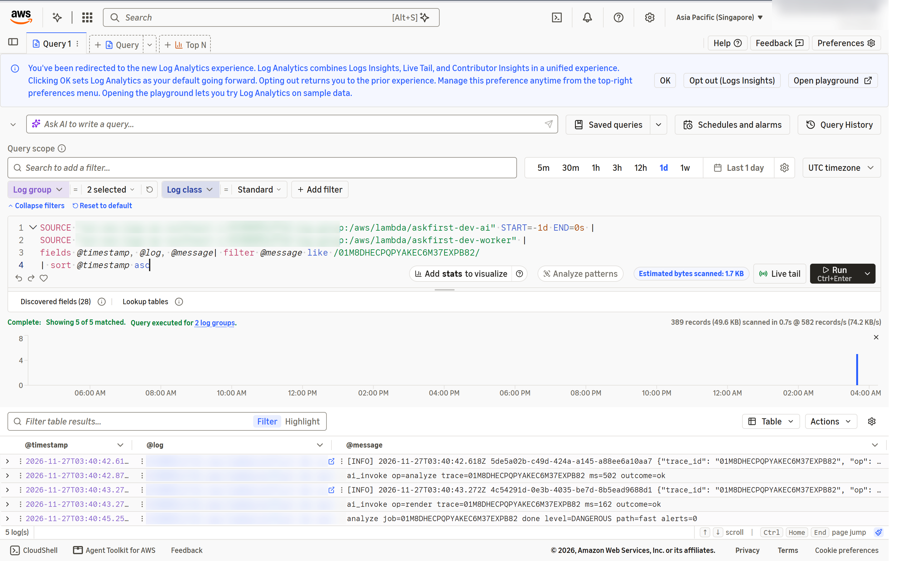
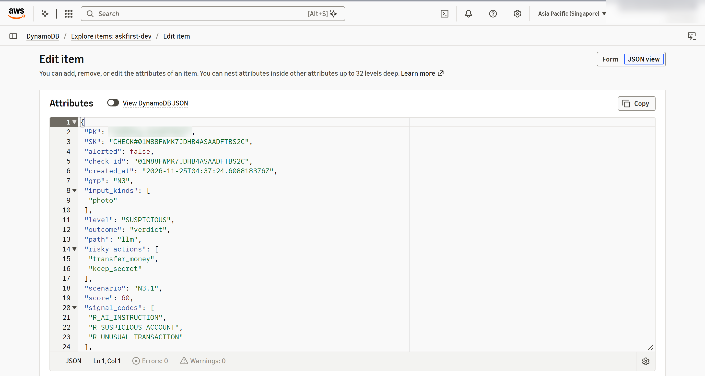

Tôi kiểm thử theo ba tầng, từ trong ra ngoài: gọi thẳng Lambda `ai` bằng request mẫu, gửi tin thật qua bot, rồi cố tình làm hỏng một thành phần để xem hệ thống phản ứng thế nào.

#### 5.7.1 Gọi thẳng Lambda `ai` bằng request mẫu

Script dưới gọi alias `live` với từng request trong `contracts/fixtures/` và đọc dòng `REPORT` trong log trả về (`LogType=Tail`) để lấy thời gian chạy và RAM:

```python
import base64, json, re, boto3, pathlib
lam = boto3.Session(profile_name="ai2test", region_name="ap-southeast-1").client("lambda")
fx = pathlib.Path("contracts/fixtures/analyze")
for name in ["otp", "default", "link", "smalltalk", "unreadable"]:
    req = json.loads((fx / f"{name}.json").read_text(encoding="utf-8"))["request"]
    r = lam.invoke(FunctionName="askfirst-dev-ai:live", Payload=json.dumps(req).encode(), LogType="Tail")
    body = json.loads(r["Payload"].read())
    report = re.search(r"Duration: ([\d.]+) ms.*Max Memory Used: (\d+) MB", base64.b64decode(r["LogResult"]).decode(), re.S)
    v = body["analyze"]["verdict"]
    print(name, v["level"], v["path"], report.groups())
```

Kết quả chạy ngày 27/11/2026 trên version mới nhất (commit `e3027ff`, LLM bật):

| Request | Mức rủi ro | Đường xử lý | Thời gian Lambda | Ghi chú |
|---|---|---|---|---|
| `otp` ("Gửi mã OTP cho tôi"), **cold start** | `DANGEROUS` | `llm` | INIT 8,7 s + 2,4 s | Gọi đầu tiên sau một thời gian không dùng |
| `default` (tin chào hỏi) | `LOW_RISK` | `escalated` | 4,1 s | Luật không đủ chắc, judge hỏi thêm model dự phòng |
| `link` (tin có đường link) | `SUSPICIOUS` | `escalated` | 10,5 s | Gồm cả bước mở thử link rút gọn |
| `smalltalk` | `LOW_RISK` | `fast` | 11 ms | Không gọi LLM |
| `unreadable` | `UNSURE` | `fast` | 10 ms | Không gọi LLM |
| `default`, gọi lần hai | `LOW_RISK` | `cache` | 6 ms | Lấy lại kết luận từ DynamoDB |
| Request thiếu trường `op` | lỗi `unknown_op` | | 2 ms | Trả lỗi có cấu trúc, không crash |
| `render` (dựng tin trả lời) | | | 88 ms | Chỉ ghép template |

RAM dùng tối đa là 930 MB trên 3008 MB. Lượt có LLM trả về cả ước tính chi phí của chính lượt đó (`cost_usd_est`, khoảng 0,0014 USD với ca `default`), cùng thời gian từng bước (`latency_ms`: luật, RAG, guard, judge).

#### 5.7.2 Chọn memory bằng số đo, không đoán

Tôi deploy cùng một image ở ba mức memory, mỗi mức gọi một lần cold start (19/11/2026, khi đã bật nạp sẵn RAG + OCR ở pha INIT):

| Memory | vCPU (ước tính) | INIT | Ảnh khi đã ấm | Kết luận |
|---|---|---|---|---|
| 1769 MB | 1 | **chạm trần 10 s** | | Lambda cắt INIT rồi chạy lại trong lần gọi: tin đầu mất 35 s |
| 2048 MB | ~1,2 | 7,1 s | 2,9–4,2 s | Chạy được nhưng sát trần |
| 3008 MB | ~1,7 | 6,2 s | 2,5–2,7 s | **Chọn** |

RAM thật chỉ khoảng 0,8 GB ở cả ba mức, nên tăng memory ở đây là để **mua CPU**, không phải mua RAM. Mỗi mức mới đo một lần, nên số INIT có thể dao động: hôm nay, sau khi thêm VietOCR, INIT ở 3008 MB là 8,7 s.

#### 5.7.3 Kiểm thử đầu cuối qua bot thật

| Kịch bản | Cách làm | Kết quả mong đợi | Kết quả |
|---|---|---|---|
| Tin chữ lừa đảo | Gửi tin giả danh công an yêu cầu chuyển tiền vào "tài khoản an toàn" | "⏳" rồi sửa thành `DANGEROUS` | Đạt (ảnh ở 5.6) |
| Gom tin | Gửi 2 tin liền nhau cách 0,5 s | Một "⏳", một kết quả gộp cả 2 tin | Đạt (24/11): job thứ nhất bị bỏ (`skip=stale`), job thứ hai phân tích cả hai tin |
| Ảnh chụp màn hình | Gửi ảnh SMS giả ngân hàng có link `i-vietcombank.com` | OCR đọc đúng link, URL intel bắt tên miền giả | Đạt (24/11): `DANGEROUS`, 11,7 s khi đã ấm |
| Link rút gọn | Tin có `tinyurl.com/...` trỏ tới tên miền giả ngân hàng | Bot mở thử bằng `HEAD`, thấy tên miền thật phía sau | Đạt (23/11): `DANGEROUS 80`, 0,39 s |
| Link rút gọn trỏ vào IP nội bộ | Link trỏ tới `169.254.169.254.nip.io` | Không kết nối tới đích (chống SSRF) | Đạt: chỉ ghi tên miền, không mở |

Tôi dùng hai cách lấy log để đối chiếu: log của `worker` và `ai` có chung `trace_id`, nên lọc theo một `trace_id` là thấy cả hành trình của một lượt kiểm tra.





#### 5.7.4 Kịch bản lỗi: chặn Lambda `ai`

Mục tiêu: chứng minh khi phần phân tích chết hẳn, người dùng vẫn được báo, và đội vận hành nhận được email.

```powershell
# 1. Chặn ai: reserved concurrency = 0 thì mọi lời gọi đều bị từ chối
aws lambda put-function-concurrency --function-name askfirst-dev-ai --reserved-concurrent-executions 0
# 2. Rút ngắn thời gian chờ giữa các lần thử để test nhanh (mặc định 720 s)
$q = aws ssm get-parameter --name /askfirst/dev/sqs/jobs_queue_url --query Parameter.Value --output text
aws sqs set-queue-attributes --queue-url $q --attributes VisibilityTimeout=150
# 3. Gửi một tin cho bot, rồi chờ khoảng 15–20 phút

# 4. TRẢ LẠI cấu hình sau khi test
aws lambda delete-function-concurrency --function-name askfirst-dev-ai
aws sqs set-queue-attributes --queue-url $q --attributes VisibilityTimeout=720
```

Kết quả (24/11/2026):

1. `worker` thử 5 lần, lần nào cũng `AiException:invoke`.
2. Ở lần thứ 5, `worker` sửa tin "⏳" thành "Dạ, hiện cháu đang bận…".
3. Job vào DLQ. `worker-dlq` thấy job này đã được báo nên ghi `already_handled` và **không gửi thêm** tin bận thứ hai.
4. Một tin B gửi trong lúc đó vẫn giữ "⏳" của riêng nó; khi bỏ chặn `ai`, B ra kết quả bình thường.
5. Alarm `askfirst-dev-jobs-dlq-not-empty` chuyển sang `ALARM`.

Bước 3 và 4 là hai lỗi tôi tìm ra ở lần test đầu (20/11): `worker-dlq` gửi tin "bận" lần hai và có thể sửa nhầm "⏳" của một tin khác. Tôi báo lại cho nhóm backend kèm cách tái hiện; bản sửa của nhóm qua được đúng kịch bản này.

#### 5.7.5 Kiểm thử ngoài AWS

Trước mỗi lần deploy, phần AI phải qua bộ test trên máy và trên CI:

```powershell
cd ai
uv run ruff check .
uv run pytest -q          # 835 test tại commit 41014e0 (PR #178)
```

CI của repo chạy thêm `OCR bench` (đo OCR trên 66 ảnh có nhãn) và `Eval gate` (so kết quả bộ luật với nhánh gốc trên bộ mẫu có nhãn) cho mỗi pull request.
