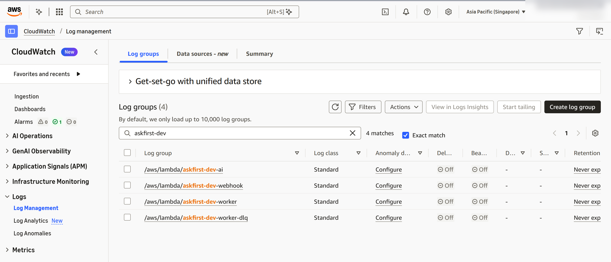
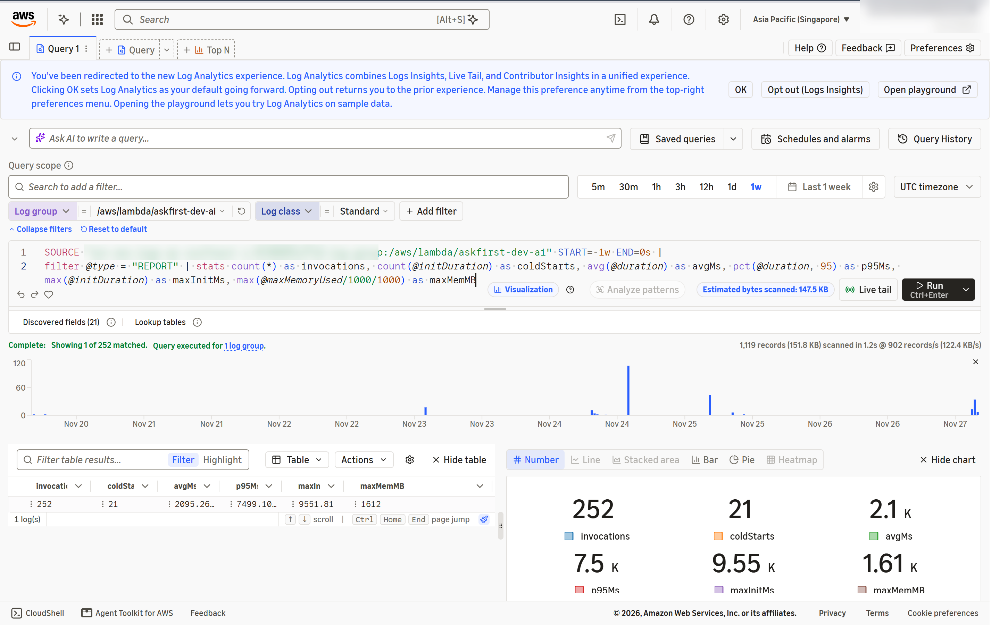
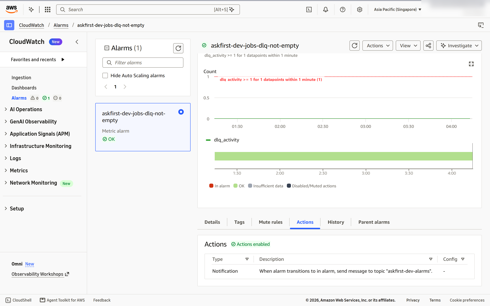

The system has no server to log in to, so all operational information comes from three CloudWatch sources: **logs** (what happened in each invocation), **metrics** (trends), and **alarms** (when human intervention is needed).

#### 5.8.1 Logs: one JSON line per invocation

Each function writes to the log group `/aws/lambda/<function name>`. The `ai` Lambda writes exactly **one JSON line** per invocation, containing only metadata:

```json
{"trace_id": "01J00000000000000000000000", "op": "analyze", "cache_hit": false, "result": "ok", "ms": 10532}
{"trace_id": "01J00000000000000000000000", "op": null, "result": "fatal/unknown_op", "cause": null, "ms": 0}
```

On the Java side, `worker` writes a corresponding line with the same `trace_id`:

```text
ai_invoke op=analyze trace=01M8DHECPQPYAKEC6M37EXPB82 ms=502 outcome=ok
ai_invoke op=render  trace=01M8DHECPQPYAKEC6M37EXPB82 ms=162 outcome=ok
```

Logs do **not** contain message content, phone numbers, tokens, or Telegram file download URLs. I verified this by scanning the logs for the exact content of the test messages and for the token string: no matches.



**Set a log retention period.** By default, log groups keep logs forever, and CloudWatch charges for storage per GB-month. Set 14 days for all 4 log groups:

```powershell
foreach ($f in "webhook","worker","worker-dlq","ai") {
  aws logs put-retention-policy --log-group-name "/aws/lambda/askfirst-dev-$f" --retention-in-days 14
}
```

#### 5.8.2 Querying with CloudWatch Logs Insights

The three queries I use most, run against the `/aws/lambda/askfirst-dev-ai` log group.

**Overall health** (cold starts, duration, memory):

```sql
filter @type = "REPORT"
| stats count(*) as invocations, count(@initDuration) as coldStarts,
        avg(@duration) as avgMs, pct(@duration, 95) as p95Ms,
        max(@initDuration) as maxInitMs, max(@maxMemoryUsed/1000/1000) as maxMemMB
```

Results for the 7 days up to 27/11/2026 (after running the test cases in 5.7):

| invocations | coldStarts | avgMs | p95Ms | maxInitMs | maxMemMB |
|---|---|---|---|---|---|
| 252 | 21 | 2,095 | 7,499 | 9,552 | 1,612 |

A `maxInitMs` of 9.55 seconds is the number to watch most closely: the INIT phase has a hard 10-second limit (see the lessons in 5.11).

**Are the models preloaded during the INIT phase:**

```sql
filter @message like /_warm/
| parse @message /"event": "(?<ev>[a-z_]+)"/
| stats count(*) by ev
```

Result: `rag_warm` 23, `ocr_warm` 22, `vietocr_warm` 19 times. The counts differ because older versions did not yet preload OCR or VietOCR.

**Following a single check across multiple functions:** select both the `worker` and `ai` log groups, then

```sql
fields @timestamp, @log, @message
| filter @message like /01M8DHECPQPYAKEC6M37EXPB82/
| sort @timestamp asc
```



#### 5.8.3 Metrics to watch

| Metric | Namespace | Meaning for Ask First |
|---|---|---|
| `Errors`, `Throttles` of `askfirst-dev-ai` | `AWS/Lambda` | The AI pipeline is failing or being throttled by concurrency limits |
| `Duration` (p95) of `askfirst-dev-ai` | `AWS/Lambda` | Image messages slowing down (OCR) or Bedrock being slow |
| `ApproximateAgeOfOldestMessage` of `askfirst-dev-jobs` | `AWS/SQS` | Jobs are stuck: users are staring at "⏳" |
| `NumberOfMessagesSent` of `askfirst-dev-jobs-dlq` | `AWS/SQS` | A job has failed permanently after 5 attempts |

#### 5.8.4 DLQ alarm sending email

The stack creates the `askfirst-dev-jobs-dlq-not-empty` alarm, which transitions to `ALARM` when a job lands in the DLQ. Because `worker-dlq` takes messages out of the DLQ almost immediately, the DLQ depth always appears to be 0; the alarm is the only way to know a job has failed.

An alarm is only useful if someone receives it. In 5.4 we passed `AlarmTopicArn` at deploy time; verify it:

```powershell
aws cloudwatch describe-alarms --alarm-names askfirst-dev-jobs-dlq-not-empty `
  --query "MetricAlarms[0].[StateValue,AlarmActions[0]]" --output text
aws sns list-subscriptions-by-topic --topic-arn <TOPIC_ARN> --query "Subscriptions[].[Protocol,SubscriptionArn]" --output text
```

`SubscriptionArn` must be a full ARN; if it is `PendingConfirmation`, the email has not been confirmed yet.



To test the alarm without waiting for a real failure:

```powershell
aws cloudwatch set-alarm-state --alarm-name askfirst-dev-jobs-dlq-not-empty `
  --state-value ALARM --state-reason "Test alarm email"
```

The email arrives within about a minute; the alarm returns to `OK` on its own at the next evaluation period.
