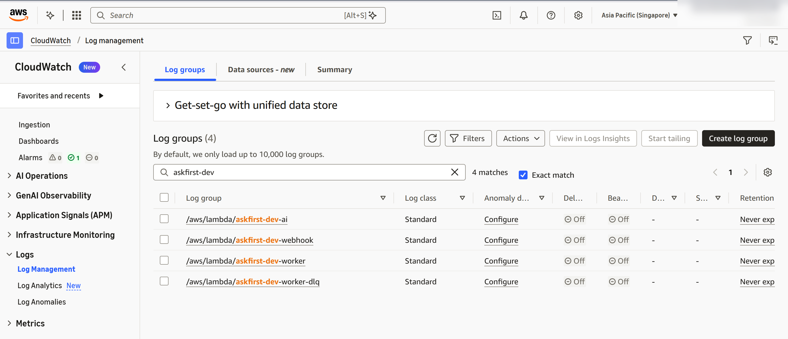
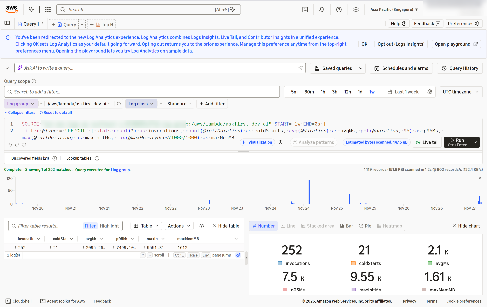
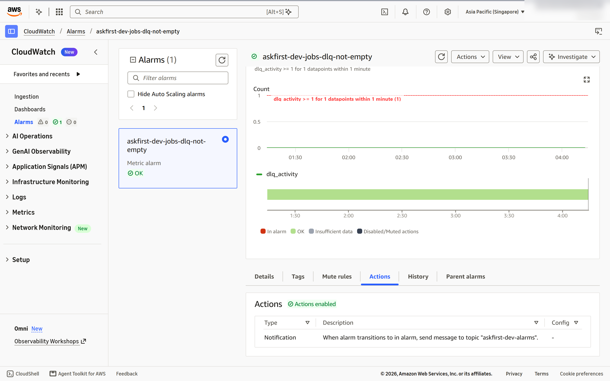

Hệ thống không có server để đăng nhập vào xem, nên mọi thông tin vận hành đến từ ba nguồn của CloudWatch: **log** (từng lượt xảy ra gì), **metric** (xu hướng), **alarm** (khi nào cần người can thiệp).

#### 5.8.1 Log: một dòng JSON cho mỗi lượt gọi

Mỗi function ghi vào log group `/aws/lambda/<tên function>`. Lambda `ai` ghi đúng **một dòng JSON** cho mỗi lần gọi, chỉ gồm metadata:

```json
{"trace_id": "01J00000000000000000000000", "op": "analyze", "cache_hit": false, "result": "ok", "ms": 10532}
{"trace_id": "01J00000000000000000000000", "op": null, "result": "fatal/unknown_op", "cause": null, "ms": 0}
```

Phía Java, `worker` ghi dòng tương ứng với cùng `trace_id`:

```text
ai_invoke op=analyze trace=01M8DHECPQPYAKEC6M37EXPB82 ms=502 outcome=ok
ai_invoke op=render  trace=01M8DHECPQPYAKEC6M37EXPB82 ms=162 outcome=ok
```

Log **không** chứa nội dung tin, số điện thoại, token hay URL tải file của Telegram. Tôi đã kiểm điều này bằng cách quét log theo đúng nội dung các tin test và theo chuỗi token: không có kết quả nào.



**Đặt thời hạn giữ log.** Log group mặc định giữ log mãi mãi, và CloudWatch tính phí lưu trữ theo GB-tháng. Đặt 14 ngày cho cả 4 log group:

```powershell
foreach ($f in "webhook","worker","worker-dlq","ai") {
  aws logs put-retention-policy --log-group-name "/aws/lambda/askfirst-dev-$f" --retention-in-days 14
}
```

#### 5.8.2 Truy vấn bằng CloudWatch Logs Insights

Ba truy vấn tôi dùng nhiều nhất, chạy trên log group `/aws/lambda/askfirst-dev-ai`.

**Sức khoẻ tổng quát** (cold start, thời gian, RAM):

```sql
filter @type = "REPORT"
| stats count(*) as invocations, count(@initDuration) as coldStarts,
        avg(@duration) as avgMs, pct(@duration, 95) as p95Ms,
        max(@initDuration) as maxInitMs, max(@maxMemoryUsed/1000/1000) as maxMemMB
```

Kết quả 7 ngày tới 27/11/2026 (sau khi đã chạy các ca kiểm thử ở 5.7):

| invocations | coldStarts | avgMs | p95Ms | maxInitMs | maxMemMB |
|---|---|---|---|---|---|
| 252 | 21 | 2.095 | 7.499 | 9.552 | 1.612 |

`maxInitMs` 9,55 giây là con số cần theo dõi nhất: pha INIT bị giới hạn cứng 10 giây (xem bài học ở 5.11).

**Model có được nạp sẵn ở pha INIT không:**

```sql
filter @message like /_warm/
| parse @message /"event": "(?<ev>[a-z_]+)"/
| stats count(*) by ev
```

Kết quả: `rag_warm` 23, `ocr_warm` 22, `vietocr_warm` 19 lần. Số lần lệch nhau vì các version cũ chưa có bước nạp sẵn OCR hoặc VietOCR.

**Theo một lượt kiểm tra qua nhiều function:** chọn cả log group của `worker` và `ai`, rồi

```sql
fields @timestamp, @log, @message
| filter @message like /01M8DHECPQPYAKEC6M37EXPB82/
| sort @timestamp asc
```



#### 5.8.3 Metric nên theo dõi

| Metric | Namespace | Ý nghĩa với Ask First |
|---|---|---|
| `Errors`, `Throttles` của `askfirst-dev-ai` | `AWS/Lambda` | Pipeline AI lỗi hoặc bị giới hạn concurrency |
| `Duration` (p95) của `askfirst-dev-ai` | `AWS/Lambda` | Tin ảnh chậm dần (OCR) hoặc Bedrock chậm |
| `ApproximateAgeOfOldestMessage` của `askfirst-dev-jobs` | `AWS/SQS` | Job đang kẹt: người dùng đang nhìn "⏳" |
| `NumberOfMessagesSent` của `askfirst-dev-jobs-dlq` | `AWS/SQS` | Có job thất bại hẳn sau 5 lần |

#### 5.8.4 Alarm DLQ gửi email

Stack tạo alarm `askfirst-dev-jobs-dlq-not-empty`, chuyển sang `ALARM` khi có job vào DLQ. Vì `worker-dlq` lấy message ra khỏi DLQ gần như ngay lập tức, nhìn độ sâu DLQ lúc nào cũng thấy 0; alarm là cách duy nhất để biết đã có job hỏng.

Alarm chỉ có ích khi có người nhận. Ở 5.4 ta đã truyền `AlarmTopicArn` khi deploy; kiểm lại:

```powershell
aws cloudwatch describe-alarms --alarm-names askfirst-dev-jobs-dlq-not-empty `
  --query "MetricAlarms[0].[StateValue,AlarmActions[0]]" --output text
aws sns list-subscriptions-by-topic --topic-arn <ARN_TOPIC> --query "Subscriptions[].[Protocol,SubscriptionArn]" --output text
```

`SubscriptionArn` phải là một ARN đầy đủ; nếu là `PendingConfirmation` thì email chưa được xác nhận.



Muốn thử alarm mà không phải chờ có lỗi thật:

```powershell
aws cloudwatch set-alarm-state --alarm-name askfirst-dev-jobs-dlq-not-empty `
  --state-value ALARM --state-reason "Thu email canh bao"
```

Email tới trong khoảng một phút; alarm tự quay về `OK` ở chu kỳ đánh giá kế tiếp.
