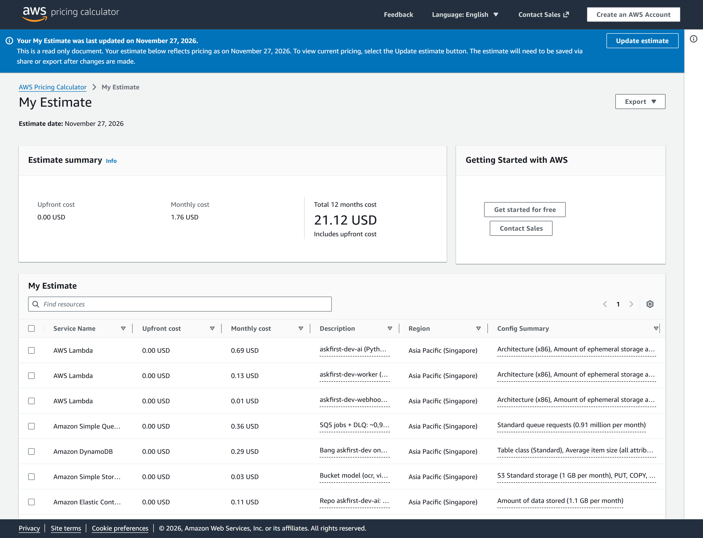

This section answers two questions: how much building and testing the system **actually cost**, and how much running **3,000 checks per month** (the project's target load) would cost. What sets this estimate apart: Lambda durations come from **measurements on real Lambda** (5.7, 5.8), not from a dev machine.

#### 5.9.1 Actual cost of building and testing

Cost Explorer, filtered by `RECORD_TYPE = Usage` (usage cost before credits), 01–26/11/2026, whole account:

| Service | USD |
|---|---|
| AWS Cost Explorer (API) | 0.0700 |
| Amazon ECR | 0.0168 |
| Amazon Bedrock | 0.0061 |
| Amazon S3 | 0.0022 |
| Amazon DynamoDB | 0.0005 |
| AWS Lambda | 0.0003 |
| SQS, SNS, CloudWatch, KMS, CloudFormation | 0 (within the Free Tier) |
| **Total** | **≈ 0.096**, fully covered by credits, amount due 0 USD |

Two takeaways:

- **The largest item turned out to be the Cost Explorer API**: each `ce:GetCostAndUsage` call costs 0.01 USD, and I called it many times while writing the report. Viewing costs in the console is free; only call the API when you need automation.
- ECR is the only time-based charge: each `ai` image takes about 0.36 GB at 0.10 USD/GB-month. Keeping many old tags costs money steadily even though nobody uses them.

Bedrock is small in the table above because most of the team's LLM calls run in the separate Bedrock account (5.1).

#### 5.9.2 Assumptions for 3,000 checks per month

| Assumption | Value | Source |
|---|---|---|
| Text / image ratio | 70% / 30% | Assumption |
| Checks that call the LLM | 75% (25% go through the fast path or cache) | Assumption based on the design; actual ratio not yet measured |
| `ai` analyzing text with LLM | 4.1 s | Measured on Lambda 27/11 (5.7.1) |
| `ai` analyzing an image with LLM | 9 s | 5.5 s OCR + rules measured on Lambda 24/11, plus about 3.5 s for the judge |
| `ai` building the reply (`render`) | 0.09 s | Measured on Lambda 27/11 |
| `worker` | equal to `ai` duration + 0.6 s for sending to Telegram | `worker` waits for `ai` to return |
| SQS requests | 0.91 million/month | **Measured**: 211,401 empty receives in 7 days (Lambda long polling), extrapolated to 30 days |
| LLM tokens per check | 0.000792 USD | Measured by the team with the `judge_v3` prompt (`docs/results/cost-estimate.md`) |

From this: `ai` runs about 14,050 seconds/month in total across 6,000 invocations, i.e. an average of 2,342 ms per invocation; `worker` has 6,000 invocations averaging 2,642 ms.

#### 5.9.3 Estimate with the AWS Pricing Calculator

Public estimate: **https://calculator.aws/#/estimate?id=307350af77a0dacdf746bb155387741aead2ec84** (created 27/11/2026, Singapore Region, "Without Free Tier" selected for each item to avoid double-counting the Free Tier).



The Calculator does not yet offer Qwen3 (or gpt-oss) in Sydney, so Bedrock is calculated by hand using unit prices from the AWS Price List API.

| Component | Input / calculation | USD/month, no Free Tier | With always-free |
|---|---|---|---|
| Lambda `ai` (3008 MB, x86) | 6,000 requests × 2,342 ms, `/tmp` 1024 MB | 0.69 | 0 |
| Lambda `worker` (512 MB) | 6,000 requests × 2,642 ms | 0.13 | 0 |
| Lambda `webhook` (512 MB) | 6,000 requests × 300 ms | 0.01 | 0 |
| SQS (jobs + DLQ) | 0.91 million requests | 0.36 | 0 |
| DynamoDB on-demand | 1 GB, 15,000 writes + 15,000 reads | 0.29 | ≈ 0.01 |
| S3 | 1 GB, 500 PUT, 2,000 GET | 0.03 | 0.03 |
| ECR | 1.1 GB (keeping 3 images) | 0.11 | 0.11 |
| CloudWatch | 0.05 GB logs, 1 alarm | 0.14 | 0 |
| Bedrock LLM (calculated by hand) | 2,250 checks × 0.000792 USD | 1.78 | 1.78 |
| Bedrock Guardrails (calculated by hand) | 2,250 checks × 0.15 USD / 1,000 text units | 0.34 | 0.34 |
| SNS email, SSM Parameter Store standard | | ≈ 0 | 0 |
| **Total** | | **≈ 3.88** | **≈ 2.27** |

The "With always-free" column subtracts the non-expiring free tiers: Lambda 1 million requests + 400,000 GB-seconds, SQS 1 million requests, CloudWatch 10 alarms + 5 GB of logs, DynamoDB 25 GB of storage. These tiers are shared across the whole account.

**Observations:** more than half of the cost is the LLM. The AWS infrastructure part (Lambda, SQS, DynamoDB, S3, ECR, CloudWatch) is only about 1.8 USD/month without the Free Tier, and close to 0 with it. Each check costs about 0.0013 USD (3.88 USD / 3,000 checks), or about 33 VND.

#### 5.9.4 Optimization measures

| Measure | Savings | Status |
|---|---|---|
| No VPC/NAT Gateway: every Lambda calls AWS services through encrypted public endpoints | About 32 USD/month for the NAT Gateway alone | Applied |
| Fully serverless, DynamoDB on-demand: no hourly-billed components | Cost drops to 0 when there are no messages | Applied |
| Fast path + 24-hour cache: skip the LLM when the rules are confident or the content has already been checked | ≈ 0.00094 USD per skipped check (tokens + Guardrail) | Applied |
| Kill switch `llm_enabled=false` in DynamoDB: turn off the LLM under spam or when hitting the budget | Caps Bedrock spending | Applied |
| Choosing memory by measurement (3008 MB) instead of over-provisioning | No paying for unused RAM | Applied (5.7.2) |
| 14-day log retention | Stops log storage costs from growing month after month | Command in 5.8.1 |
| ECR lifecycle policy keeping the 3 latest images | Each old image ≈ 0.036 USD/month | Command below |
| AWS Budgets at 50 USD/month, alerts at 80% and 100% | Early detection of unusual spending | Applied (5.2) |

ECR lifecycle policy keeping the 3 most recent images:

```powershell
$rule = '{"rules":[{"rulePriority":1,"description":"keep last 3","selection":{"tagStatus":"any","countType":"imageCountMoreThan","countNumber":3},"action":{"type":"expire"}}]}'
aws ecr put-lifecycle-policy --repository-name askfirst-dev-ai --lifecycle-policy-text $rule
```

Before enabling it, check which image the `live` alias (and any version you may need to roll back to) is using: once an image is deleted, you can no longer roll back to that version.
