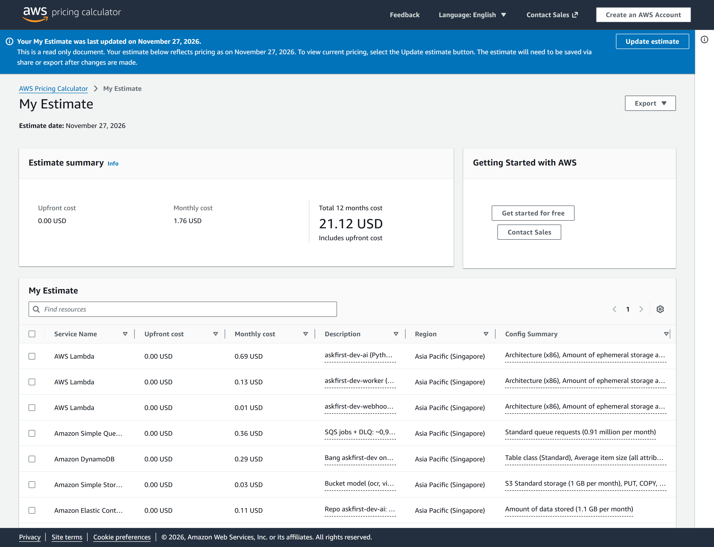

Mục này trả lời hai câu hỏi: dựng và test hệ thống **đã tốn bao nhiêu thật**, và chạy **3.000 lượt kiểm tra mỗi tháng** (mục tiêu tải của dự án) sẽ tốn bao nhiêu. Điểm khác của bản dự toán này: thời gian chạy của Lambda lấy từ số **đo trên Lambda thật** (5.7, 5.8), không lấy từ máy dev.

#### 5.9.1 Chi phí thực tế khi dựng và test

Cost Explorer, lọc `RECORD_TYPE = Usage` (chi phí sử dụng trước khi trừ credit), 01–26/11/2026, cả tài khoản:

| Dịch vụ | USD |
|---|---|
| AWS Cost Explorer (API) | 0,0700 |
| Amazon ECR | 0,0168 |
| Amazon Bedrock | 0,0061 |
| Amazon S3 | 0,0022 |
| Amazon DynamoDB | 0,0005 |
| AWS Lambda | 0,0003 |
| SQS, SNS, CloudWatch, KMS, CloudFormation | 0 (trong Free Tier) |
| **Tổng** | **≈ 0,096**, được credit trừ hết, số phải trả 0 USD |

Hai điều rút ra:

- **Khoản lớn nhất lại là Cost Explorer API**: mỗi lần gọi `ce:GetCostAndUsage` tốn 0,01 USD, và tôi gọi nhiều lần khi viết báo cáo. Xem chi phí trên console thì miễn phí; chỉ gọi API khi cần tự động hoá.
- ECR là khoản tính theo thời gian duy nhất: mỗi image `ai` chiếm khoảng 0,36 GB, giá 0,10 USD/GB-tháng. Giữ nhiều tag cũ là tốn tiền đều đặn dù không ai dùng.

Bedrock ở bảng trên nhỏ vì phần lớn lời gọi LLM của nhóm chạy ở tài khoản Bedrock riêng (5.1).

#### 5.9.2 Giả định cho 3.000 lượt kiểm tra mỗi tháng

| Giả định | Giá trị | Nguồn |
|---|---|---|
| Tỉ lệ tin chữ / ảnh | 70% / 30% | Giả định |
| Lượt có gọi LLM | 75% (25% đi fast path hoặc cache) | Giả định theo thiết kế; tỉ lệ thật chưa đo |
| `ai` phân tích tin chữ có LLM | 4,1 s | Đo trên Lambda 27/11 (5.7.1) |
| `ai` phân tích ảnh có LLM | 9 s | 5,5 s OCR + luật đo trên Lambda 24/11, cộng khoảng 3,5 s cho judge |
| `ai` dựng tin trả lời (`render`) | 0,09 s | Đo trên Lambda 27/11 |
| `worker` | bằng thời gian `ai` + 0,6 s gửi Telegram | `worker` chờ `ai` trả về |
| Request SQS | 0,91 triệu/tháng | **Đo**: 211.401 lần nhận rỗng trong 7 ngày (long polling của Lambda), quy ra 30 ngày |
| Token LLM mỗi lượt | 0,000792 USD | Nhóm đo với prompt `judge_v3` (`docs/results/cost-estimate.md`) |

Từ đó: `ai` chạy tổng cộng khoảng 14.050 giây/tháng trên 6.000 lần gọi, tức trung bình 2.342 ms mỗi lần gọi; `worker` 6.000 lần gọi, trung bình 2.642 ms.

#### 5.9.3 Dự toán bằng AWS Pricing Calculator

Dự toán công khai: **https://calculator.aws/#/estimate?id=307350af77a0dacdf746bb155387741aead2ec84** (tạo 27/11/2026, Region Singapore, chọn "Without Free Tier" ở từng mục để không bị trừ Free Tier trùng lặp).



Calculator chưa cho chọn Qwen3 (và cả gpt-oss) ở Sydney, nên phần Bedrock tính tay theo đơn giá của AWS Price List API.

| Thành phần | Nhập vào / cách tính | USD/tháng, không Free Tier | Có always-free |
|---|---|---|---|
| Lambda `ai` (3008 MB, x86) | 6.000 request × 2.342 ms, `/tmp` 1024 MB | 0,69 | 0 |
| Lambda `worker` (512 MB) | 6.000 request × 2.642 ms | 0,13 | 0 |
| Lambda `webhook` (512 MB) | 6.000 request × 300 ms | 0,01 | 0 |
| SQS (jobs + DLQ) | 0,91 triệu request | 0,36 | 0 |
| DynamoDB on-demand | 1 GB, 15.000 ghi + 15.000 đọc | 0,29 | ≈ 0,01 |
| S3 | 1 GB, 500 PUT, 2.000 GET | 0,03 | 0,03 |
| ECR | 1,1 GB (giữ 3 image) | 0,11 | 0,11 |
| CloudWatch | 0,05 GB log, 1 alarm | 0,14 | 0 |
| Bedrock LLM (tính tay) | 2.250 lượt × 0,000792 USD | 1,78 | 1,78 |
| Bedrock Guardrails (tính tay) | 2.250 lượt × 0,15 USD / 1.000 text unit | 0,34 | 0,34 |
| SNS email, SSM Parameter Store standard | | ≈ 0 | 0 |
| **Tổng** | | **≈ 3,88** | **≈ 2,27** |

Cột "Có always-free" trừ các mức miễn phí không hết hạn: Lambda 1 triệu request + 400.000 GB-giây, SQS 1 triệu request, CloudWatch 10 alarm + 5 GB log, DynamoDB 25 GB lưu trữ. Các mức này tính chung cho cả tài khoản.

**Nhận xét:** hơn một nửa chi phí là LLM. Phần hạ tầng AWS (Lambda, SQS, DynamoDB, S3, ECR, CloudWatch) chỉ khoảng 1,8 USD/tháng không có Free Tier, và gần như 0 nếu có. Mỗi lượt kiểm tra tốn khoảng 0,0013 USD (3,88 USD / 3.000 lượt), tức khoảng 33 đồng.

#### 5.9.4 Các biện pháp tối ưu

| Biện pháp | Tiết kiệm | Trạng thái |
|---|---|---|
| Không dùng VPC/NAT Gateway: mọi Lambda gọi dịch vụ AWS qua endpoint công khai có mã hoá | Khoảng 32 USD/tháng cho riêng NAT Gateway | Đã áp dụng |
| Serverless toàn bộ, DynamoDB on-demand: không có thành phần tính theo giờ | Chi phí về 0 khi không có tin | Đã áp dụng |
| Fast path + cache 24 giờ: bỏ qua LLM khi luật đã chắc hoặc nội dung đã kiểm | ≈ 0,00094 USD mỗi lượt bỏ qua (token + Guardrail) | Đã áp dụng |
| Kill switch `llm_enabled=false` trong DynamoDB: tắt LLM khi bị spam hoặc chạm ngân sách | Chặn trần chi phí Bedrock | Đã áp dụng |
| Chọn memory theo số đo (3008 MB) thay vì để rộng | Không trả tiền cho RAM không dùng | Đã áp dụng (5.7.2) |
| Đặt thời hạn giữ log 14 ngày | Chặn chi phí lưu log tăng dần theo tháng | Lệnh ở 5.8.1 |
| ECR lifecycle policy giữ 3 image mới nhất | Mỗi image cũ ≈ 0,036 USD/tháng | Lệnh bên dưới |
| AWS Budgets 50 USD/tháng, cảnh báo 80% và 100% | Phát hiện sớm chi phí bất thường | Đã áp dụng (5.2) |

ECR lifecycle policy giữ 3 image gần nhất:

```powershell
$rule = '{"rules":[{"rulePriority":1,"description":"keep last 3","selection":{"tagStatus":"any","countType":"imageCountMoreThan","countNumber":3},"action":{"type":"expire"}}]}'
aws ecr put-lifecycle-policy --repository-name askfirst-dev-ai --lifecycle-policy-text $rule
```

Trước khi bật, kiểm tra alias `live` (và version bạn có thể cần quay về) đang dùng image nào: image bị xoá thì không quay về version đó được nữa.
